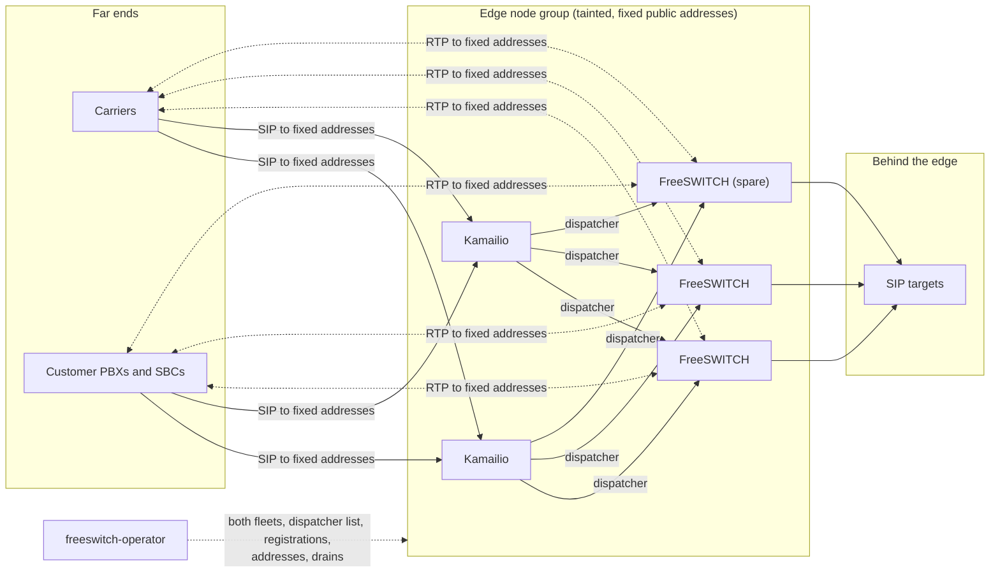
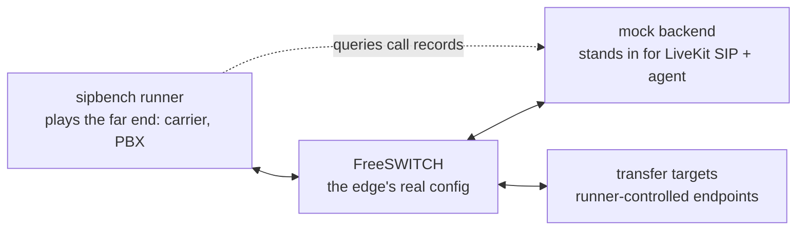

# FreeSWITCH Operator

A Kubernetes operator for running a fleet of FreeSWITCH nodes as a SIP edge (an SBC) behind a Kamailio proxy, plus
**sipbench**, a SIP test bench that checks call flows against that edge before real traffic moves onto it.

> **Status: early, under construction (v0).** The API is `v1alpha1` and will change. The plan below is the design we
> are building toward; the [milestones](#milestones) describe what is in place today. The
> [sipbench report card](sipbench/report-card/README.md) shows how the edge did in the latest release's bench runs.

## Why this exists

FreeSWITCH runs well on Kubernetes once a few non-default things are true, and every team that does it must rebuild
the same pieces by hand:

- **Media needs the node's own network.** Overlay pod networking breaks RTP: signaling succeeds and audio silently
  fails. FreeSWITCH has to run with `hostNetwork: true` and a planned RTP port range, which means one FreeSWITCH
  pod per node.
- **Peers need fixed public addresses.** Carriers and customer PBXs allow-list our IPs, for signaling and often
  for media, in both directions. A pod on the host network uses its node's address, and nodes are replaced all the
  time (upgrades, node expiry, failures). A network load balancer covers inbound signaling only: a request we
  originate leaves from the node's own address, and RTP can't pass through it at all.
- **Calls last minutes; the defaults assume seconds.** A node must stop taking new calls, let its live calls
  finish, and only then go away. That has to hold for rolling updates, node drains and autoscaler consolidation.
- **The proxy in front has to know who can take a call.** Kamailio's dispatcher list must follow the fleet as
  nodes join, drain and leave.
- **Call recovery is an address move.** FreeSWITCH can resume a failed node's tracked calls on another node, but
  only if the far end's packets still arrive, which means the failed node's address moves with its calls, and
  the failed node must never hold it again (no split brain).

## Architecture



- **Kamailio** holds the fixed signaling addresses, registers to carriers that need it, and spreads new calls
  across FreeSWITCH nodes with its dispatcher module. The operator runs it as a managed resource
  ([`KamailioCluster`](#7-kamailio-as-a-managed-resource-m2)).
- **FreeSWITCH** ends every call leg, anchors media and runs the call: bridging, transfers, codecs, headers.
  Per-peer policy isn't kept here; it is data in the Kamailio fleet ([loop 9](#9-per-peer-behaviour-m5)). Each
  node runs on the host network, one per node, with its RTP range open in the node's security group, and advertises
  its own fixed public address for media. No media relay sits in front of it; rtpengine beside Kamailio stays an
  option for later (see [Decisions](#decisions)).
- **The operator** owns both fleets and everything around them: the headless services, the dispatcher list,
  outbound registrations, each node's public address, drains, rolling updates, and (from v1) failover.
- **Behind the edge**, FreeSWITCH bridges calls to a SIP target. In the bench that is sipbench's mock backend; later
  it is LiveKit SIP, and through it the agent runtime.

## The `FreeswitchCluster` resource

One resource describes one fleet. A sketch of where the API is heading (fields marked *v0* exist today; the rest
are planned):

```yaml
apiVersion: sip.instruments.com/v1alpha1
kind: FreeswitchCluster
metadata:
  name: edge
  namespace: telephony
spec:
  replicas: 3                       # v0. One pod per node; keep one spare for updates and failover
  image: drachtio/drachtio-freeswitch-mrf:0.9.6     # pin by digest; must contain freeswitch and fs_cli
  nodeSelector:                     # v0. Pin to the edge node group
    node-role.example.com/sip-edge: "true"
  tolerations: []                   # v0
  sip:
    port: 5060                      # v0. The profile Kamailio dispatches to
  rtp:
    portRangeStart: 16384           # v0. Must match the node security group
    portRangeEnd: 32768
  externalAddress:
    source: NodeExternalIP          # v0: NodeExternalIP | None. M3: AddressPool
    # addressPoolRef: {name: edge-media}       # M3, with AddressPool: a cluster-scoped SIPAddressPool (loop 4)
  config:
    mountPath: /usr/local/freeswitch/conf   # v0. Point FreeSWITCH here with -conf
    configMapRefs:                  # v0. Each ConfigMap's keys become files in its directory; an edit rolls the fleet
      - {name: edge-freeswitch-conf, path: "."}
      - {name: edge-freeswitch-profiles, path: sip_profiles}
  drain:
    maxDrainSeconds: 7200           # v0. Upper bound on waiting for live calls to finish
  dispatcher:
    setID: 1                        # v0. Kamailio dispatcher set for this fleet
    configMapName: edge-dispatcher  # v0. The operator writes dispatcher.list here
    jsonrpcURL: ""                  # v0, optional. Kamailio JSON-RPC endpoint (port 5070 in the example); a
                                    #   Service name reaches every ready Kamailio pod behind it
  metrics:                          # M2c, optional. A Prometheus exporter beside FreeSWITCH in each pod
    exporterImage: <registry>/freeswitch-exporter@sha256:…   # pin by digest; a change rolls the fleet
    port: 9282                      # /metrics on the pod's (node's) own address
status:
  readyReplicas: 2
  members:                          # v0. One entry per pod
    - pod: edge-0
      node: ip-10-0-1-23
      address: 10.0.1.23            # what Kamailio dispatches to (the node's private address)
      externalAddress: 203.0.113.10 # what peers see
      state: Active                 # Starting | Active | Draining
  currentRevision: edge-7c9d…
  updateRevision: edge-7c9d…
  conditions: []
```

## Control loops

Each loop is small and does one thing. Numbering matches the order we build them.

### 1. Fleet: pods, service and disruption budget (v0)

The operator renders a StatefulSet with:
- `hostNetwork: true` and `dnsPolicy: ClusterFirstWithHostNet`, so the pod uses the node's network but can still
  resolve cluster services;
- a required pod anti-affinity on the hostname, so there is never more than one FreeSWITCH per node (ports clash
  otherwise);
- `updateStrategy: OnDelete`, so the operator, not the StatefulSet controller, decides when a pod is replaced;
- `terminationGracePeriodSeconds` set from `drain.maxDrainSeconds`, so a draining pod is not killed early;
- a `preStop` hook, a startup probe and a readiness probe from scripts the operator ships in a ConfigMap (below),
  so any image with `freeswitch` and `fs_cli` works. **Startup** passes once FreeSWITCH is ready with a SIP profile
  running on `sip.port`, the port Kamailio sends to; FreeSWITCH calls itself ready even with no profile loaded. A pod
  that doesn't get there within two minutes is restarted, which costs nothing: it has never been ready, so it holds
  no calls. **Readiness** adds "not draining" and, when required, "knows its external address", and keeps
  re-checking the profile, so a profile that stops later takes the node out of dispatch without touching its calls.
  **Liveness is opt-in** (`spec.liveness`): a failure restarts the container and drops every call on the node, and
  `fs_cli` can be slow under load, so a false positive at peak would do more harm than the hang it guards against.
  A crash needs no probe, since the process exits and the container restarts. With `liveness: {}` the probe fails
  only when FreeSWITCH doesn't answer `fs_cli status` at all (not ready, paused and draining all count as alive),
  checking every 30 s with a 15 s timeout and restarting after 10 misses in a row, about five minutes of silence.
  `fs_cli` gives up two seconds before the probe does, so a slow answer is a counted miss, never a killed probe.
- a downward-API volume of the pod's annotations, through which the operator hands the pod its external address
  (loop 4).

It also creates a headless Service selecting the pods (readiness decides membership) and a PodDisruptionBudget
with `maxUnavailable: 1`.

### 2. Dispatcher membership (v0)

**The headless service's EndpointSlices are the source of truth: a ready endpoint takes new calls.** The operator
watches them and:
1. renders Kamailio's `dispatcher.list` (one line per ready node, set `dispatcher.setID`) into the ConfigMap named
   by `dispatcher.configMapName`. A `KamailioCluster` that dispatches to the fleet reads it and drives its own pods
   ([loop 7](#7-kamailio-as-a-managed-resource-m2)); a Kamailio you run yourself mounts it;
2. for a Kamailio you run yourself, if `dispatcher.jsonrpcURL` is set, calls Kamailio's JSON-RPC: `dispatcher.set_state` to take a draining node out
   immediately, then `dispatcher.reload` once the new list should be on disk (`dispatcher.reloadDelaySeconds`, a
   guess at the kubelet's sync time). After each reload it reads the list back (`dispatcher.list`) and reloads
   again every 10 s until Kamailio holds the one it wrote. When the URL names a Service in the cluster,
   each call goes to every ready Kamailio pod behind it rather than to the one the Service would pick, so every
   Kamailio hears of each change; a Kamailio that starts later reads the current list from disk.

Kamailio's own OPTIONS probing (`ds_ping_interval`) stays on as a backstop, and FreeSWITCH answers new calls with
`503` while paused, so dispatcher fails over on a `503` during the gap between "not ready" and "Kamailio knows".

### 3. Drains and rolling updates (v0)

**One mechanism serves both: a pod is drained by deleting it, and its `preStop` hook does the waiting.**
- `preStop` marks the pod as draining (readiness fails at once, so loop 2 removes it from dispatch), runs
  `fsctl pause inbound`, and waits until `show calls count` reaches zero or `maxDrainSeconds` passes. If FreeSWITCH
  is still starting, it first waits (up to 60 s) for it to be ready: FreeSWITCH loses a SIGTERM that arrives while
  it starts, and the pod would then sit `Terminating` for its whole grace period.
- **Rolling update:** when the pod template changes, the operator replaces one pod at a time, only while every
  other pod is ready and none is terminating: delete, wait for the replacement to pass readiness, move on. A
  replacement that never gets its SIP profile up stops the roll there, with the rest of the fleet still serving.
- **Node drain, autoscaler consolidation or node expiry:** eviction respects the PodDisruptionBudget, and the same
  `preStop` drain runs under the same long grace period. (Planned: the operator sets `karpenter.sh/do-not-disrupt`
  on pods with live calls; to be verified against EKS Auto Mode before we rely on it.)
- **Keep a spare.** With one pod per node, an update without a spare runs a node short for its whole length.

### 4. External addresses (v0 node addresses; pool in M3)

FreeSWITCH must put its public address in SDP (`ext-rtp-ip`); its SIP headers keep its own address (`ext-sip-ip`),
since peers signal only through Kamailio, which reaches it there and advertises the public address itself. The
operator writes it
on each pod as the annotation `sip.instruments.com/external-address`; the pod reads it from its downward-API
volume, which, unlike environment variables, updates in place. The bundled `vars.xml` example uses FreeSWITCH's
`exec-set` pre-processor to read it at start.
- **v0, `source: NodeExternalIP`:** the address comes from the node's `ExternalIP`.
- **M3, `source: AddressPool`:** a `SIPAddressPool` holds a fixed list of addresses and binds one to each edge node,
  Kamailio's and FreeSWITCH's alike. When a node is replaced, its address moves to the replacement. One spare node
  and one spare address are the norm. Pools work the same whatever provides the addresses: AWS Elastic IPs and
  MetalLB (on kind and on-prem) today, and later other clouds and plain routed addresses.

**Pools and providers.** A pool is cluster-scoped, like a `GatewayClass`: addresses and nodes are cluster-wide, and
two pools must never hold the same address. Its spec names exactly one provider, each with its own block, so a new
provider is a new block rather than a new resource:

```yaml
apiVersion: sip.instruments.com/v1alpha1
kind: SIPAddressPool
metadata:
  name: edge-media
spec:
  awsElasticIP:                     # M3. Existing Elastic IPs, associated with each node's instance
    region: us-east-1
    allocationIDs: [eipalloc-…, eipalloc-…, eipalloc-…]
  # metalLB:                        # M3. Addresses MetalLB announces (L2 or BGP)
  #   ipAddressPool: sip-edge       #   the MetalLB IPAddressPool that holds them
  #   addresses: [192.168.1.240, …]
  # static:                         # planned. Routed to the nodes by something else (BGP, keepalived, by hand)
  #   addresses: [198.51.100.10, …]
status:
  datapath: NAT                     # NAT | Local, from the provider
  fencing: Authoritative            # Authoritative | Advisory, from the provider
  addresses:
    - id: eipalloc-…
      address: 203.0.113.10
      state: Bound                  # Free | Bound | Idle | Conflict | Error
      node: ip-10-0-1-23
      nodeID: i-0abc…
      claimedBy: [{kind: FreeswitchCluster, namespace: telephony, name: edge, pod: edge-1}]
      lastClaimedBy: [{kind: FreeswitchCluster, namespace: telephony, name: edge, pod: edge-1}]
      # bindAddress: 10.0.1.57      # when pods bind something other than the node's own address
      # bindAddressReady: true      #   and the node's address agent has it on its interface
  conditions: []                    # Ready, Degraded, ProviderAvailable
```

A fleet sets `externalAddress: {source: AddressPool, addressPoolRef: {name: …}}`. Signalling and media can draw from
separate pools, even with different providers. The pool controller does everything that doesn't depend on the
provider, once, tested against a fake provider: which address goes to which node, keeping a node's address while it
lives, giving a replaced node's address to its replacement, holding the spare, conditions and status, and the pod
annotations. A provider ([`internal/addresspool`](internal/addresspool/provider.go)) only names nodes, observes,
binds and unbinds:

```go
type Provider interface {
	Capabilities() Capabilities                     // Datapath (NAT | Local), Fencing (Authoritative | Advisory)
	NodeID(n *corev1.Node) (string, error)          // the provider's name for a node (an instance ID)
	Observe(ctx context.Context) ([]Address, error) // where each address is bound now; truth, not our status
	Bind(ctx context.Context, a Address, nodeID string) error // refuses an address bound anywhere
	Unbind(ctx context.Context, a Address) error    // Authoritative: works with the node dead or unreachable
}
```

The planner's rules, the same for every provider:
- A node running a pod that uses the pool holds one address, `Bound`, for as long as the node lives, through rolling
  updates and drains (a draining pod still claims it). A node with none of those pods keeps any address it has,
  `Idle`: a spare, or a node between pods.
- A node that needs an address gets, in order: a free or idle address one of its pods used last (`lastClaimedBy`),
  so a StatefulSet pod replaced onto a new node keeps its address; any free address; then an idle one, moved off its
  node. With none left, the pool is `Degraded` and the node's pods wait without an address (unready, when
  `required`).
- An address the pool bound to a node that has left the cluster is unbound and reused. One bound outside the cluster
  that the pool didn't put there is a `Conflict`, left alone.
- An address the provider can't report on is an `Error`, and its node keeps it, so a provider outage doesn't make
  pods unready or move addresses.
- A pod waits for its address before it starts. FreeSWITCH and Kamailio both read it once, at start, and a pool binds
  it only once the pod is on its node, which takes seconds on AWS; started sooner, they would advertise the node's
  private address for their whole life. Kamailio's entrypoint already waits when the address is `required`; a
  FreeSWITCH fleet that draws from a pool and requires its address gets an init container (`wait-for-address`, in
  the FreeSWITCH image) that waits for the downward-API file, which the kubelet fills in within seconds of the
  annotation (checked on kind). Fleets on other sources get no such container, so their pod template is unchanged.
- The pool rereads its provider 5 s after binding or unbinding, and every 5 minutes otherwise, to see changes made
  outside the operator. Deleting a pool leaves its addresses where they are, since they may be carrying calls.

**Datapath: how the address reaches the node.** Providers don't differ only in API calls, and the difference
changes what the fleets render:

| | `NAT` | `Local` |
| --- | --- | --- |
| Providers | AWS Elastic IP; GCP, Azure and OCI reserved addresses | MetalLB (L2 or BGP), kube-vip, keepalived or BGP on-prem |
| The node sees | only its private address; the cloud translates 1:1 | the address itself, on an interface |
| FreeSWITCH | `rtp-ip` private, `ext-rtp-ip` the public address | `rtp-ip` and `ext-rtp-ip` both the address |
| Kamailio | `listen` on the private address, `advertise` the public one | `listen` on the address, plus the private listener FreeSWITCH uses |
| Replies and outbound traffic | leave from the address through the translation | leave from the address only because the process binds to it |

So when a pool's address reaches the node at an address the node doesn't already have (an AWS pool with
`privateAddress: Secondary`, or a `Local` provider such as MetalLB), each pod gets a second annotation beside
`sip.instruments.com/external-address` (what it advertises): `sip.instruments.com/bind-address` (what it binds RTP,
or Kamailio's peer-facing listener, to), from the pool's `status.addresses[].bindAddress`. Pods of other pools bind
their node's own address, as they always have. FreeSWITCH's SIP profile stays on the private address either way:
Kamailio dispatches to it there, and peers only ever signal through Kamailio.

- **FreeSWITCH** gets a `bind-address` downward-API file (`FS_BIND_ADDRESS_FILE`) in a fleet that draws from a pool;
  sipbench's config ([`bin/podinfo.sh`](sipbench/freeswitch/conf/bin/podinfo.sh)) sets `rtp-ip` from it,
  falling back to `local_ip_v4`, and then advertises the external address for RTP only (`ext-rtp-ip`). `ext-sip-ip`
  is always `local_ip_v4`, with a pool or without: the external address may reach only the bind address, where SIP
  doesn't listen, or reach the node only through the cloud's translation, and a Contact naming it strands the
  dialog's ACK and BYE or sends them the long way round. FreeSWITCH uses the `ext-` addresses only for peers outside
  the profile's `local-network-acl`, and with the default (`localnet.auto`) Kamailio, which every call comes
  through, is inside it: on a `NAT` pool carriers were then offered the private bind address, and their media never
  arrived. So the `trunks` profile sets `local-network-acl` to an ACL that matches nothing, and every caller gets
  the external address; callers inside the cluster (sipbench) reach it through the cloud's translation, so the
  node's security group must let them in. The operator renders Kamailio's config but not FreeSWITCH's: a
  FreeSWITCH config of your own needs the same, or its RTP leaves from the node's address and the pool's address
  never carries it.
- **Kamailio** with a bind address listens on it, advertising the public address, and separately on the pod's own
  address for FreeSWITCH, instead of on `0.0.0.0`, so replies leave from the address the request came to. A new
  request leaves from the side it is going to (`force_send_socket`: toward a node from the pod's address, toward a
  peer from the bind address); requests in a dialog follow the double Record-Route that leaves.
- **The address agent** ([`config/components/address-agent`](config/components/address-agent/kustomization.yaml)), a
  DaemonSet in the manager's image with host networking and `NET_ADMIN`, puts each bind address its node is given on
  the interface that holds the node's own address (a /32 labelled `<interface>:sip`) and reports what its node has on
  its own pod (`sip.instruments.com/bind-addresses`). Whether an address needs it is the provider's to say: it reports
  a bind address for the binding, and the agent and the pool need to know nothing else about the provider. The pool
  reads the agents' reports and marks each such address `bindAddressReady` once its node's agent has it; only then
  does the address count as the node's for its pods, so the operator sets a pod's external and bind addresses
  together and a pod never starts binding an address that isn't there. A new agent pod that hasn't reported yet (a
  rollout) changes nothing; one that reports the address gone takes it back. The agent removes only addresses it
  labelled that no pool gives its node, and never one that a pool which can't read its provider (`ProviderAvailable`
  False) names anywhere in its status, so a provider outage never takes an address off a node while other pools'
  moved addresses still leave. Deleting a pool does take its bind addresses off the nodes' interfaces: delete one
  only when no fleet uses it.
- **A just-bound address** waits for the pool's next read (5 s) to confirm it, and to learn its bind address, before
  the node's pods are given it: its status shows a message until then.

**Fencing: what unbinding guarantees.** `Authoritative` means one API call takes the address off a node whether or
not the node is alive (AWS's `DisassociateAddress`). `Advisory` means a node cut off from the cluster but not from the
network may go on holding the address (MetalLB stops announcing it from that node, but the node's own interface
still has it). Failover (loop 5) moves addresses on its own only for `Authoritative` pools, unless a pool opts in.

**Rules for every provider.**
- The operator never allocates or releases an address: peers allow-list them, so the pool is a fixed list. It only
  binds and unbinds, and only addresses listed in the pool.
- A pool is checked against the provider, not against its own status: after a restart it reads bindings back
  before acting.
- Providers are turned on with a manager flag (`--address-providers=aws,metallb`; repeated flags add up, so the
  kustomize components combine), so the operator holds the permissions of the providers in use only. A pool whose
  provider isn't enabled reports `ProviderUnavailable`.

**AWS Elastic IPs.** The pool lists existing allocation IDs (see
[`config/samples`](config/samples/sip_v1alpha1_sipaddresspool.yaml)). A node is named by the instance in its
provider ID. Binding associates the Elastic IP with the primary private address of the instance's primary network
interface, naming the interface, since AWS refuses an instance ID alone once an instance has a second interface (EKS
nodes with the VPC CNI usually do). It uses `AllowReassociation=false`, so it never takes an address from anything
else, and it refuses an instance that already holds an Elastic IP outside the pool. An address associated with an
interface that belongs to no instance (a NAT gateway, a load balancer) is a `Conflict`; an allocation ID that doesn't
exist is an `Error` on that address alone. The manager's service account needs `ec2:DescribeAddresses`,
`ec2:DescribeNetworkInterfaces`, `ec2:AssociateAddress` and `ec2:DisassociateAddress`, through IRSA or EKS Pod
Identity.

`privateAddress: Secondary` is for nodes whose own address already holds an Elastic IP the pool must not touch (a
cluster endpoint, as on a one-node sandbox). Binding assigns the node's primary interface a new secondary private
address, records it on the Elastic IP as the tag `sip.instruments.com/private-address`, and associates the Elastic
IP with it; a failed association takes the address back. Unbinding disassociates, then unassigns only the address
the tag names (never a primary address), and removes the tag. The address agent then puts the address on the node's
interface. This needs `ec2:AssignPrivateIpAddresses`, `ec2:UnassignPrivateIpAddresses`, and `ec2:CreateTags` and
`ec2:DeleteTags` on Elastic IPs for that one tag key. Don't use it where the CNI hands out the primary interface's
secondary addresses to pods (the VPC CNI does): it could hand out this one, fill the interface's address limit, or
release it as surplus, which disassociates the Elastic IP. So the pool refuses to bind a new address to a node
running the VPC CNI's `aws-node` pod (the node waits, and the pool's Ready condition says why); an address already
bound there stays. On EKS, use `Primary` on a dedicated edge node group, in public subnets: an Elastic IP's replies
must leave through an internet gateway, not a NAT gateway.

Enabling it: add [`config/components/aws-address-pool`](config/components/aws-address-pool/kustomization.yaml)
(`--address-providers=aws`) to `config/default`'s components, and for `Secondary` pools
[`config/components/address-agent`](config/components/address-agent/kustomization.yaml) as well (a Flux
Kustomization on `./config/default` takes `spec.components`). Give the manager's service account a role with
[`iam-policy.json`](config/components/aws-address-pool/iam-policy.json) (its last two statements are for `Secondary`
only), by IRSA annotation or Pod Identity association.

**MetalLB.** MetalLB only announces addresses that belong to a `LoadBalancer` Service, and a Service can't carry
FreeSWITCH's 16k-port RTP range. So for each binding the pool keeps a Service of its own in the operator's namespace
(`sip-<pool>-<address>`) that asks MetalLB for the address (`metallb.io/loadBalancerIPs`, and
`metallb.io/address-pool` when the pool names `ipAddressPool`), with `externalTrafficPolicy: Local`, no selector,
and an EndpointSlice the pool writes naming the node. MetalLB announces the address from that node only and won't
give it to any other Service; the pool reports an address another Service asks for or holds as a `Conflict`, and
leaves it alone. One MetalLB hasn't assigned (not in an IPAddressPool) stays bound, with a message, but its node's
pods aren't given it and the node counts as waiting. A Service whose EndpointSlice has gone announces nothing, so
the pool counts its address as unbound and the next bind completes it. Taking an address out of the spec deletes its
Service, so MetalLB stops announcing it. The Service's one port is a placeholder
(discard, 9/UDP): kube-proxy rewrites traffic to a Service's ports, and SIP and RTP must reach the pods untouched.
The address agent (above) puts the address on the node's interface while it is bound there, so the node delivers
every port locally and the pods bind it; unbinding deletes the Service and the agent takes the address off. Fencing
is `Advisory`: a node cut off from the cluster keeps the address on its interface.

Enabling it: install MetalLB with an IPAddressPool holding the addresses and an L2Advertisement or BGPAdvertisement
for it, run MetalLB's speaker on the fleets' nodes (give it their tolerations), and add
[`config/components/metallb-address-pool`](config/components/metallb-address-pool/kustomization.yaml) and
[`config/components/address-agent`](config/components/address-agent/kustomization.yaml) to `config/default`'s
components. On kind ([below](#the-edge-on-kind)), MetalLB in L2 mode on the Docker network gives the
FreeSWITCH fleet its addresses, so the pool, the agent and media to the pooled address are checked in CI.

### 5. Failover with fencing (v1, M4)

When a node dies mid-call: fence it (its address is unbound before anything else happens; automatically only where
the pool's fencing is `Authoritative`, [loop 4](#4-external-addresses-v0-node-addresses-pool-in-m3)), move its address
to the spare, and have the spare run `sofia recover` against the shared call-tracking database (`track-calls` on the
SIP profiles, PostgreSQL behind). This is the riskiest loop and the most valuable, so it comes after sipbench can
kill a node mid-call and check the outcome, which it now can: `node-lost-mid-call` takes a call's node off the
network for two minutes (`sipbench blackout`, tc drop filters on the node's own interface) and checks the rest of
the fleet keeps taking calls. Until failover a node's calls drop when it dies (FreeSWITCH ends them at its media
timeout, and nothing tells the backend), and new calls go elsewhere: within Kamailio's 5 s failover at first, with
no delay once the dispatcher's probes have taken the node out.

### 6. Configuration from git (v0 mounting; M5 typed)

v0 assembles FreeSWITCH's configuration directory from ConfigMaps that Flux applies from git. Each reference names a
directory under `config.mountPath` (`.` for the top, `autoload_configs`, `sip_profiles`, ...), and the operator lays
the ConfigMaps' keys out there as one read-only projected volume, so a whole tree like FreeSWITCH's own fits. Pods
never mount the ConfigMaps themselves: the kubelet would push an edit into every running pod within a minute, ahead
of any drain. The operator copies each one into an immutable ConfigMap named by a hash of its contents
(`<cluster>-config-<hash>`), and each revision of the pod template mounts its own copies. An edit therefore makes a
new template, which loop 3 rolls through one drained node at a time, while pods not yet replaced keep the files they
started with. Copies no template or pod uses any more are deleted. A missing or empty ConfigMap, or two claiming
the same path, marks the fleet `Degraded`, leaves the running pods alone and pauses any roll in progress. (An empty
one is nearly always an accident, and rolling it out could remove a whole directory, such as every SIP profile; to
ship an empty directory on purpose, drop the reference.)
In M5, typed resources take over, each reloaded where it lives. Peer resources (loop 9) render into the Kamailio
fleet and reload over its JSON-RPC. FreeSWITCH keeps only its own config (profiles, and the ACL of who may reach
it), reloaded with `reloadxml` and `reloadacl`.

### 7. Kamailio as a managed resource (M2)

A `KamailioCluster` runs the proxy fleet the same way a `FreeswitchCluster` runs the media fleet: a StatefulSet
(`<name>-kamailio`) with one pod per node on the host network, a fixed public address each, the same one-at-a-time
roll, and the operator in charge of its config. `spec.dispatch` names the `FreeswitchCluster`s it sends calls to, in
priority order; each must set `spec.dispatcher`, whose `setID` becomes that fleet's dispatcher set. See
[`config/samples`](config/samples/sip_v1alpha1_kamailiocluster.yaml).

- **Config:** the operator renders `kamailio.cfg` from a template
  ([`kamailio.cfg.tmpl`](internal/controller/kamailio.cfg.tmpl)) into an immutable ConfigMap named by its hash.
  It routes:
  - a new call from a peer to the first set in `spec.dispatch` with an active node, round-robin within it
    (`ds_select_routes`), failing over on `503` or no answer to the set's next node and then to the next set's;
  - requests from a FreeSWITCH node to the request URI, so peers always see Kamailio's address;
  - in-dialog requests along their route set; one without Kamailio's route, or a CANCEL that matches nothing, gets
    `481` (a stray ACK is dropped);
  - OPTIONS keepalives from peers (no user part), answered by Kamailio itself: `200` with an `Allow` header while any
    set has an active node, `503` while none has or while the pod drains, so peers route elsewhere.

  With `spec.trustedPeers` set, only those sources (each a named list of CIDRs) and the fleet's own FreeSWITCH nodes
  get any of that: a request from anywhere else, inside a dialog or not, is dropped before Kamailio answers anything,
  so a scanner learns nothing and a forged route set can't make Kamailio relay for a stranger. It guards signaling
  only; carriers send media straight to FreeSWITCH (often from other addresses: Twilio signals from `/30`s per edge
  and sends media from `168.86.128.0/18`), so the firewall in front of the FreeSWITCH nodes' RTP range admits those.
  Empty trusts every source. The list is in the rendered config, so changing it rolls the fleet; M5's peer resources
  (loop 9) take it over as a `permissions` table that reloads live. `make check-kamailio-trust` runs Kamailio in the
  pinned image and checks a trusted source gets an answer and an untrusted one gets none.

  It also inserts `Max-Forwards: 70` when missing, refuses requests that require an extension it doesn't support
  (`420`), and takes messages up to 64 KB over UDP and TCP (Kamailio's defaults stop at 32 KB). It answers `400`
  itself to a From or To that every FreeSWITCH node would discard without a word: a display name outside quotes with
  anything but token characters in it (a comma, `@`, UTF-8), or a bare URI with a comma or question mark. Requests it
  relays onward wait RFC 3261's 32 s; a new call fails over after 5 s without any answer, and the dispatcher's probes
  use the same 5 s. A `503` takes a node out of rotation at once; silence alone doesn't, since a
  node is also silent when it discards a request it can't parse (one malformed INVITE would otherwise empty the
  fleet), so a node that has stopped answering leaves rotation after two missed probes, 10 to 20 s. A `503` from the
  last node is passed on as `503`. `make check-kamailio-cfg`
  runs `kamailio -c` on rendered cases in the pinned image, in the lint workflow. Peer data (loop 9) and
  registrations (loop 8) join the config in M5.
- **Metrics.** Each pod serves Prometheus metrics at `/metrics` on `spec.metrics.port` (default 5071), on its own
  address only and without a token, for a Prometheus server or an OpenTelemetry Collector to scrape: Kamailio's own
  statistics (`kamailio_tm_*`, `kamailio_sl_*`, `kamailio_core_*`, ...) and the edge's counters:
  - `kamailio_rejected_requests_total{reason}`: refused before any node saw it; `display_name` (the `400` above),
    `sanity` (sanity's own `4xx`), `uri_scheme` (`416`), `untrusted_source` (dropped unanswered, with
    `spec.trustedPeers` set).
  - `kamailio_node_silent_timeouts_total`: a node didn't answer within 5 s.
  - `kamailio_silent_drops_total{cause}`: every node tried stayed silent and the caller got `408`. `cause="request"`
    when a node answered something else meanwhile: the nodes are up and discarded this request, a malformed one we
    don't yet refuse, or an attack. `cause="nodes"` when none did: the fleet itself may be down. Both want an alert.

  Each refusal and silent drop is also logged with its source address and Call-ID; neither goes into a label.
- **Most changes are live; a short list restarts.** The restart list is the rendered config and the pod template:
  listening ports, loaded modules and their parameters, the routing script, and the order of `spec.dispatch` (the
  sets are in the routing). A change to one of those makes a new snapshot and a new template, and the fleet rolls one
  pod at a time, which is cheap because a Kamailio drain is short. Everything else reloads live: today that is
  membership, the dispatcher list.
- **Membership is live.** Each `FreeswitchCluster` keeps publishing its own dispatcher list. The `KamailioCluster`
  combines its fleets' lists into `<name>-dispatcher`, which its pods mount as a directory, with every destination
  flagged for probing (Kamailio's probes take a dead node out on their own). When a destination leaves, the operator
  marks it inactive on every ready Kamailio pod at once, by pod address. Once `reloadDelaySeconds` have passed it has
  each pod reload, reads each pod's list back, and reloads again every 10 s until every pod holds the combined list
  (`status.dispatcherReloadedHash`). A fleet that is missing, has no `spec.dispatcher`, or reuses another's `setID`
  is left out and named in the `SetConflict` condition.
- **JSON-RPC is authenticated.** Kamailio's JSON-RPC has no authentication of its own, and NetworkPolicy doesn't
  apply to host-network pods. So the operator keeps a random token in a Secret (`<name>-jsonrpc`), the pods get it
  as an environment variable, and the HTTP route answers `401` to any request without it. The RPC listener binds to
  the pod's own address only (on the host network, the node's private address); keep the port closed in the security
  group too. A `FreeswitchCluster`'s `jsonrpcURL` remains for a Kamailio you run yourself, without a token.
- **Updates and drains:** Kamailio holds transactions, not calls, so a drain is short (`drain.maxDrainSeconds`,
  default 40). The `preStop` hook makes the pod unready, sets a shared variable over JSON-RPC so new calls from
  peers get `503` (they retry another Kamailio) while FreeSWITCH's own requests and in-dialog requests still pass,
  and waits until `tm.stats` shows no open transactions. Calls already up hold no transaction: their in-dialog
  requests follow the node's address to the replacement pod. The dispatcher's own probes count as transactions, so
  with dead destinations a drain can run to its limit. From M5, a pod that holds registrations hands them over first
  (loop 8).
- **One Kamailio fleet by default.** Per-peer behaviour is data in that fleet (loop 9), not a fleet per peer. Because
  a `FreeswitchCluster` publishes its membership as a ConfigMap, more than one `KamailioCluster` can dispatch to the
  same FreeSWITCH fleet. That is for isolation: a lane whose bad config or overload can't reach the other, or that
  upgrades on its own schedule. Behaviour alone isn't a reason for one, and neither is a peer on the inside network
  (loop 10 covers those in the one fleet).
- **Not yet:** TLS, rate limiting of scanners (`pike`), allow-listing peers, and refusing a source whose requests the
  nodes keep discarding (it needs known peers exempted, so a carrier isn't cut off for a few bad calls; M5). Kamailio listens on `0.0.0.0` and
  advertises the public address, so a reply leaves from whatever address the kernel picks, unless its pool gives the
  pod a `bind-address` to listen on (loop 4).

### 8. Outbound registrations (M5, when a peer needs them)

Some carriers send inbound calls only to an address that has registered for the number, with a username and
password. The registration names one address (its `Contact`), so it belongs on the proxy, whose address is fixed,
not on a FreeSWITCH node that can drain or die. Many peers don't register at all: they recognise the edge by its
source address, or challenge each call. So this loop is built when the first peer needs it, as a field of that
peer (loop 9).
- Kamailio's `uac` module registers for each configured number and re-registers before expiry; the carrier then
  sends calls to Kamailio, which dispatches them like any other.
- Credentials come from a Kubernetes Secret; the operator renders the registrations table and reloads it over
  JSON-RPC.
- **Registration mode is per peer**, because carriers treat several contacts for one number differently: some
  try each one, some keep only the latest, some reject the second.
  - `single` (the default) registers from one Kamailio pod. When that pod drains, the operator moves the
    registration to another pod in the order that carrier accepts. Either it registers the new contact first and
    then removes the old one, or it removes the old one first and accepts a short gap. sipbench's registrar mocks
    and a test call decide which order a carrier needs. If the registering pod fails instead of draining, the
    operator registers from another pod as soon as it sees the pod isn't ready. Registrations use a short expiry,
    so a carrier stops sending to a dead contact soon, even if nothing re-registers.
  - `perReplica` registers from every pod, so the carrier can fail over by itself. It's turned on per peer, once
    sipbench and a test call against that carrier show it accepts several contacts.

### 9. Per-peer behaviour (M5)

Each peer (a carrier, a voice AI provider, a customer PBX) needs its own handling at the edge. A typed peer
resource carries it, and the operator renders it into the Kamailio fleet's config. No route block is written per
peer. Behaviours peers need in practice, and the Kamailio feature that covers each one:

| Peer needs | Kamailio |
| --- | --- |
| Recognise the peer by its source address | `permissions` address table: address to peer tag |
| Several signaling addresses for one peer, each with its own health checks (some peers want none) | A dispatcher set per peer; the operator marks which destinations to probe (below) |
| A fixed Request-URI host (its termination hostname); numbers in E.164 | Per-peer rewrite rules (`dialplan` module) |
| A digest challenge the edge answers itself, rather than passing it back to the caller | `uac_auth()` with the peer's credentials, from a Secret |
| REFER handled at the edge, or passed on to the peer | Per-peer flag, sent to FreeSWITCH in a header (below) |
| Reached on the inside network (a VPN), with no NAT | Loop 10 |
| Inbound calls only after registering | Loop 8 |

- **Reloads.** Peer data lives in `db_text` tables the operator renders: `permissions` addresses, `dialplan` rules,
  `uac` registrations, and an `htable` for per-peer flags and digest credentials. Each reloads over JSON-RPC.
  `uac_auth()` reads credentials from AVPs filled from that table, not from the static `credential` parameter. The
  module docs don't fully settle whether that works without the parameter, so sipbench's challenging peer mock
  confirms it, and confirms that `db_text` serves each module, before M5 relies on them. Nothing here is on the
  restart list (loop 7).
- **Health checks are per destination.** The template runs `ds_probing_mode 3`, which keeps probing only the
  destinations that carry the probing flag (`8`) in the dispatcher list. The operator sets that flag on every
  FreeSWITCH node, and on a peer's destinations unless that peer asked for no health checks. (The v0 example probes
  every destination with mode 1; the M2 template switches.)
- **Dispatcher set IDs don't collide.** A fleet's `spec.dispatcher.setID` stays the user's choice, limited to 1–99.
  Sets the operator creates (a peer's, or a fleet's inside set from loop 10) take IDs from 100 up, recorded in the
  owning resource's status. From M2 the operator renders the whole list, so a collision becomes a condition instead
  of one set overwriting another.
- **What FreeSWITCH needs to know travels in headers.** Kamailio removes any `X-Edge-*` header a peer sent, so a
  peer can't forge one. It then adds the peer's tag (`X-Edge-Peer`) and the flags FreeSWITCH acts on, such as
  `X-Edge-Refer: edge|pass`. FreeSWITCH's dialplan reads them. With `edge`, it sets `force_transfer_context` and
  places the transfer itself, as sipbench does today. With `pass`, it passes the REFER on to the peer.

### 10. Peers on the inside network (M6)

Some peers reach the edge over a VPN into the VPC rather than over the internet, with no NAT on either side. For
them, both fleets have to use the nodes' internal addresses, for signaling and media alike. The public address that
FreeSWITCH advertises (loop 4) would send their RTP somewhere they can't reach.
- **FreeSWITCH:** a second SIP profile on the node's private address, advertising that address in SDP (no
  `ext-rtp-ip`). The operator publishes the fleet's members on that profile as a second dispatcher set.
- **Kamailio:** an inside listening address beside the public one. For an inside peer, Kamailio sends from it and
  dispatches to the fleet's inside set. A new listening address is on the restart list (loop 7), so adding one
  rolls the fleet; attaching the address touches the node anyway.
- **Network:** the VPN routes to the edge node subnet, and the security group opens SIP and the RTP range to the
  peer's networks. Peers allow-list the subnet, not node addresses, since nodes are replaced.
- **sipbench:** a peer mock on a second network checks that the SDP it receives carries an inside address and that
  audio flows both ways.

## Voice detection for barge-in (proposed)

If FreeSWITCH becomes the voice detector for barge-in (the caller talking over the agent should cut the agent off),
the edge needs the following. None of it is built or scheduled on a milestone yet.

**Requirements**
- **In the audio path of every call that should have barge-in, decoding it for the whole call.** Signaling alone,
  or audio passed straight through (`proxy_media`, `bypass_media`), won't do. The edge already anchors every call's
  media: FreeSWITCH ends both legs and nothing in sipbench's config bypasses it. But with `inherit_codec` both legs
  share a codec, so nothing is transcoded today. Detection needs linear audio on every such call, so a decode, plus
  the detector's own work, so capacity has to be sized (and benched) with detection on every call, not on a few.
- **Listen only to what arrives from the caller.** On the caller's leg FreeSWITCH keeps the two directions apart:
  the read stream is what the caller sends, and the write stream is what we send to the caller. Detection runs on
  the read stream only. On a mixed stream there is no telling who is talking.
- **Cancel our own echo.** Some of what we play comes back on the caller's side, from speakerphones and some lines.
  Uncancelled, the detector hears our agent and we barge ourselves. Being in the path is what makes cancelling
  possible: FreeSWITCH has what it just sent to compare against.
- **Know when we're talking.** FreeSWITCH sees when our side is playing audio to the caller, so the bar for
  calling something caller speech can be higher during those moments.
- **Serve the record-and-send flows too.** If any of the older record-and-send flows stay, the same detector serves
  them.

**What the image gives us.** These were checked in the pinned image (`drachtio/drachtio-freeswitch-mrf:0.9.6`) by
listing its modules, applications, linked libraries and usage strings. None of it has been tried on a call yet.
- `mod_vad_silero`, a Silero neural VAD (ONNX Runtime), as `uuid_vad_silero <uuid> start|stop one-shot|continuous
  threshold silence-ms speech-pad-ms min-speech-ms [bugname]`. Its threshold is a speech probability, so it can be
  raised while we play.
- `mod_vad_detect`, FreeSWITCH's own VAD (libfvad, WebRTC's), as `uuid_vad_detect <uuid> start|stop
  one-shot|continuous mode silence-ms voice-ms [bugname]`. `vad_test` in `mod_dptools` uses the same VAD.
- `preprocess` (an application) and `uuid_preprocess` (an API), with `echo_cancel`, `echo_suppress`,
  `noise_suppress`, `agc` and `dereverb` options, backed by speexdsp, which `libfreeswitch` links. This is the
  out-of-the-box echo canceller.
- `mod_avmd` (answering-machine beep detection) and `mod_audio_fork` (streams a call's audio over a websocket),
  plus several transcription and speech-to-speech modules we don't need for this.

These are drachtio's and jambonz's modules, not stock FreeSWITCH: relying on them ties us to this image or to
building them ourselves ([decision 4](#decisions)).

**The switch: edge or agent, per call.** To compare detecting in the switch against detecting in LiveKit,
sipbench's edge configuration loads both modules and makes the choice per call, with a fleet-wide default
([`vars.xml`](sipbench/freeswitch/conf/vars.xml), [`dialplan/trunks.xml`](sipbench/freeswitch/conf/dialplan/trunks.xml)):

| Variable (a `FreeswitchCluster`'s `spec.env`) | Default | |
| --- | --- | --- |
| `BARGE_IN_VAD` | `livekit` | `livekit`: the edge detects nothing, and the agent behind LiveKit SIP runs its own. `freeswitch`: the edge cancels echo and detects, as below |
| `BARGE_IN_VAD_ENGINE` | `silero` | with `freeswitch`: `silero` (`mod_vad_silero`) or `webrtc` (`mod_vad_detect`) |
| `BARGE_IN_ECHO_CANCEL` | `1024` | with `freeswitch`: `preprocess`'s `r.echo_cancel` on what the caller sends; `0` for none |

- **Per call:** a caller's `X-Barge-In-VAD: livekit|freeswitch` header overrides the fleet's mode (any other value
  is ignored). Kamailio's per-peer data (M5) can set it per peer. Changing the fleet's default changes `spec.env`,
  which rolls the fleet one drained node at a time.
- **The backend is always told**: the backend leg carries `X-Barge-In-VAD` with the mode in force, so the agent
  knows whether to run its own detector or listen for the edge's (LiveKit SIP can map a header to a participant
  attribute).
- **With `freeswitch`**, once the call is answered: echo cancellation, then a detector, on what the caller sends
  (media bug `caller`), and a second detector on what the agent sends, which is what the caller hears (media bug
  `agent`). That second detector is how the edge knows when we're talking. Events go out on the event socket on
  each change, told apart by `media-bugname`: `CUSTOM vad_silero:detect` (`detected-event: start_talking` or
  `stop_talking`, with a JSON body carrying the window's `probability`) or `vad_detect:detection` (the same two,
  no probability). On kind, a call with the mode set gets `preprocess` and `caller` media bugs on the caller's leg
  and an `agent` bug on the backend leg; a `livekit` call gets none.
- **Each detection goes to the agent as a SIP INFO** on the backend leg (`Content-Type:
  application/x-barge-in+json`), whichever party it was heard in:
  `{"event":"speech-started","party":"caller","engine":"silero","probability":0.98,"at":1795229956441}`.
  `event` is `speech-started` or `speech-stopped`, `party` is `caller` or `agent`, `probability` is Silero's only,
  and `at` (Unix ms) is when the speech started or stopped as the detector dates it. The image has no scripting
  module to do this inside FreeSWITCH, so the metrics exporter beside it does it
  ([`internal/fsexporter/relay.go`](internal/fsexporter/relay.go)): it subscribes to the detectors' events on the
  event socket and calls `uuid_send_info` on the call's agent leg (the dialplan names that leg's uuid in advance).
  This means detections are relayed only in a fleet that sets `spec.metrics`. `-barge-in-relay=false` (or
  `BARGE_IN_RELAY=false`) turns the relay off. Its metrics are `freeswitch_barge_in_relay_connected` and
  `freeswitch_barge_in_detections_total{party,event,result}`, where `result` is `relayed`, `no_target` or
  `failed`. FreeSWITCH sends an INFO only to a far end that says it takes them (`X-FS-Support: send_info`), so the
  agent leg sets `fs_send_unsupported_info`.
- **The relay can't see whether the agent accepted an INFO.** `uuid_send_info` returns as soon as the INFO is
  queued, so a 405 from the far end goes unnoticed and `relayed` counts INFOs sent, not INFOs received.
- `sipbench`'s `barge-in-vad-mode` checks the switch end to end on kind, against the mock agent:
  - the default mode, the header override, and audio unaffected both ways with the detectors and the echo
    canceller in the path;
  - a caller talking over the agent's tone: the agent gets `caller` start and stop INFOs and no `agent` ones;
  - an agent talking over the caller's tone: `agent` INFOs and no `caller` ones;
  - a `livekit` call: no INFOs at all.

  The talking is sipbench's synthetic speech (a `speech` step), which Silero scores 0.97 to 0.99, as it does
  recorded speech. Tones don't count as speech, and speexdsp logs resetting its echo canceller on them ("acting
  funny and got slapped"), which pure tones are known to cause.

**First measurements** (kind, one 8 kHz PCMU call from a FreeSWITCH node to the mock backend, about 8 s of
synthetic speech sent toward the backend and the detectors on that leg). In these runs `mod_vad_silero` had been
loaded by hand (`load mod_vad_silero`), and then it reported every 60 ms window with its probability rather than
only changes; loaded at startup it reports changes only, which isn't understood yet. The per-window probabilities
are what the numbers below count.
- **Each detector hears only its leg's incoming audio.** With our speech going out and only a tone coming back,
  Silero's probability stayed under 0.03 throughout; `mod_vad_detect` fired on the incoming tone and not on our
  speech.
- **Without echo cancellation we barge ourselves.** With the mock echoing our speech back, Silero put 74% of the
  windows during our speech at 0.5 or above.
- **FreeSWITCH's echo canceller helps, but not alone.** With `r.echo_cancel=1024` that fell to 51% over the 8 s:
  80 to 95% in the first three seconds while speexdsp converges, then 0 to 40%. A longer tail with
  `r.echo_suppress=-60` gave the same numbers, which isn't explained yet. So the higher bar while we're talking (the
  `agent` detector) is needed, not optional. The mock's echo is a clean digital copy; a real speakerphone's is
  harder.
- **The agent hears of a barge-in about 260 ms after the caller starts talking**, and of the stop about 120 ms
  after they stop. The relay adds about 10 ms of that. The rest is the detector's own minimums at their defaults:
  250 ms of speech before it calls a start, and 100 ms of silence before it calls a stop. Both are arguments to
  `uuid_vad_silero` (`barge_in_vad_args`), so they can be tuned.

**Still to find out**
- **LiveKit SIP drops the INFOs, so we patch it.** Upstream (`livekit/sip`, read at v1.24.0, the version
  platform-gitops runs) registers no INFO handler: any INFO gets 405, and nothing in it reaches the room. It maps
  headers to participant attributes only from the initial INVITE. A patch, on the `sip-info-to-room` branch of
  [spiegela/sip](https://github.com/spiegela/sip/tree/sip-info-to-room) (a public fork of `livekit/sip`, one commit
  on v1.24.0), adds a config option, `info_topics`, mapping a body
  content type to a data packet topic:

  ```yaml
  info_topics:
    application/x-barge-in+json: barge-in
  ```

  An INFO of a listed type on an inbound call is published to the call's room as a reliable data packet from the
  SIP participant, its body unchanged, and answered 200. Any other type gets 415, and a body over 15 KiB gets 413.
  Without the option, INFO is answered 405 as before. The agent gets each detection from its room's data callback
  on topic `barge-in`, from the participant `sip_<number>`.
  - **Tested:** its unit tests (forwarding in order, content type matching, 415, 413, 481, and 405 without the
    option) and LiveKit SIP's whole unit suite pass. An integration test against a real LiveKit server in Docker
    has an agent in the room receive two detections sent as INFO, with the same body as the edge sends. The patched
    image builds (`livekit-sip:info-dev`, locally).
  - **Tested end to end on kind** (`hack/kind.sh livekit`, then the bench's `barge-in-livekit` scenario): a caller
    through Kamailio and the edge to the patched LiveKit SIP, into the room of a stand-in agent (sipbench's
    `lkagent`). The agent receives the caller's start and stop as data packets on `barge-in` and nothing from the
    agent's side while it is silent. It also sees the call's mode as a participant attribute, mapped by the trunk's
    `headers_to_attributes` from `X-Barge-In-VAD`. With the agent detecting, no packets come. The agent gets a start
    about 270 ms after the speech starts and a stop about 120 ms after it stops, so LiveKit SIP and the room add
    only a few milliseconds to the relay's figures above.
  - **Learned on the way:** LiveKit SIP answers a call only once its participant has subscribed to someone's track
    in the room. An agent that publishes no audio leaves the call ringing until the edge gives up (NO_ANSWER, then
    the fallback). A real agent publishes its voice. The stand-in publishes silence.
  - **Still to decide:** the fork lives in a personal GitHub account for now. Still open are which registry serves
    its image, before platform-gitops can run it, and whether to offer the change upstream (a pull request from the
    fork), which would spare us carrying it.
- **What the agent does in each mode:** with `livekit`, its own VAD drives interruptions as today; with
  `freeswitch`, it should turn that off and act on the edge's signal.
- **Why a hand-loaded `mod_vad_silero` reported every window** while one loaded at startup reports changes. A
  consumer wants changes, so this matters only if the per-window mode turns up in production.
- **The cost of a Silero session per leg**: each detector creates its own ONNX session at answer (about 40 to 60 ms
  on kind) and holds it for the call.
- Why the echo canceller's tail setting changed nothing, and how it does on a real speakerphone's echo.
- **The cost per call** (decode, echo cancellation, Silero on two legs), measured on the bench, and what it does to
  sessions per node.
- **Echo on the bench:** with the INFOs, the bench now sees the detector's verdict. A scenario where the agent talks
  and the caller echoes it back (sipbench's `echo` step) should give no `caller` INFOs. It isn't written yet, and
  the measurements above suggest it would fail today.

## Metrics and alerts

**Every component serves Prometheus metrics; an OpenTelemetry Collector scrapes them and sends them on over OTLP,
and alert rules shipped here watch them.** Nothing in the edge depends on them: they are for people and alerts.

- **Kamailio** serves its statistics and the edge's counters at `/metrics` on `spec.metrics.port` (default 5071):
  refusals, silent node timeouts and silent drops (see [loop 7](#7-kamailio-as-a-managed-resource-m2)).
- **FreeSWITCH**, with `spec.metrics` set on a `FreeswitchCluster`, gets an exporter in each pod
  ([`cmd/freeswitch-exporter`](cmd/freeswitch-exporter)). It reads FreeSWITCH over the event socket at each scrape
  and serves `/metrics` on the pod's own address (default port 9282): `freeswitch_up` (the socket answered; nothing
  else is reported when it doesn't, so a dead node never shows stale numbers), `freeswitch_ready`, sessions
  (active, peak, total, the limit and the rate limit), `freeswitch_calls` and `freeswitch_channels`,
  `freeswitch_inbound_paused` (1 while the node drains), and per SIP profile its state and its calls and failed calls
  in each direction. It runs as a native sidecar, so it keeps reporting while the node drains and stops only after
  FreeSWITCH has. It is its own image, versioned apart from the operator: the exporter is part of the pod template,
  so changing its image rolls the fleet, which an operator upgrade alone never does. It reads the event socket
  password from `spec.metrics.eventSocket.passwordSecretRef`, or uses FreeSWITCH's default as `fs_cli` does.
- **The operator** serves controller-runtime's metrics (reconciles, work queues, the Go runtime) on its HTTPS
  metrics endpoint (`:8443`, for callers allowed `GET /metrics`: bind the `metrics-reader` ClusterRole), plus its own,
  each naming a fleet by `kind`, `namespace` and `name`: `freeswitch_operator_fleet_members{state}` (Starting,
  Active, Draining), `_fleet_desired_replicas`, `_fleet_outdated_members` (above zero during a roll),
  `_fleet_condition{condition}`, `_fleet_pod_replacements_total`, `_fleet_drain_started_timestamp_seconds{pod}` and
  `_fleet_max_drain_seconds` (a drain's age against its limit), `_fleet_drain_duration_seconds` (how long each drain
  took), and for the dispatcher `_dispatcher_destinations{set}`, `_dispatcher_list_updates_total`,
  `_dispatcher_reloads_total{result}`, `_dispatcher_set_inactive_total{result}` and `_dispatcher_pending_reload`
  (a changed list not every Kamailio is confirmed to hold). Each `SIPAddressPool`'s series name it by `pool`:
  `freeswitch_operator_address_pool_addresses{state}`, `_address_pool_nodes_waiting`,
  `_address_pool_addresses_awaiting_agent` (bound addresses whose node's address agent hasn't reported the bind
  address), `_address_pool_provider_calls_total{call,result}` and `_address_pool_last_observed_timestamp_seconds`.
- **Alert rules** live in [`config/alerts/edge-alerts.yaml`](config/alerts/edge-alerts.yaml), in Prometheus's
  rule-file format, for Prometheus, Grafana Mimir or Amazon Managed Service for Prometheus;
  `make check-alerts` checks them and runs their unit tests with promtool. Critical: silent drops with the whole
  fleet silent, FreeSWITCH not answering, a fleet with no member taking calls. Warning: silent drops of single
  requests (malformed traffic or an attack), repeated silent node timeouts, a SIP profile down, sessions near the
  limit, a fleet short of members with nothing draining, a roll stalled with nothing draining, a drain past 80% of
  its limit, a dispatcher reload pending for 5 minutes, a dispatch set conflict, the operator gone, a node using an
  address pool with none of its addresses, a pool address in `Conflict` or `Error`, a pool that hasn't read its
  provider for 15 minutes, a pool address waiting on its node's address agent. Info: a pool with no spare address.
- **The scrape config** in [`deploy/kind/monitoring`](deploy/kind/monitoring/collector.yaml) is the reference: pods
  with a port named `metrics` in each fleet (the rules expect `job` = `kamailio` or `freeswitch`, and `namespace`,
  `pod` and `fleet` labels) and the operator's metrics Service. On kind the Collector sends to a Prometheus with its
  OTLP receiver on, which loads the rules; in production point its OTLP exporter at your backend.

## sipbench: the SIP test bench

**sipbench proves call flows end to end through a real FreeSWITCH, with configurable mocks behind it, so each layer
can be swapped for the real thing as it is built.** It lives in [`sipbench/`](sipbench/) as its own Go module.



- **The runner** places calls into FreeSWITCH as a carrier or PBX would: headers, codecs, keypad tones, CANCEL, and
  it listens for test tones to prove two-way audio. It also answers as a transfer target.
- **The mock backend** answers what FreeSWITCH bridges to, with behaviour chosen per called number from a YAML file:
  ring, reject with a code, answer, play a tone, send keypad tones, ask for a blind transfer, hang up. It records
  what it received (headers, codecs, digits, audio) for the runner to check.
- **Backends are pluggable.** A scenario names the capabilities it needs: `mock`, and `livekit` (LiveKit SIP on
  the edge's `lk` numbers with a stand-in agent, sipbench's `lkagent`, that records what reaches its room; on kind
  with `hack/kind.sh livekit`). `runtime` (the real agent runtime) plugs in behind the same FreeSWITCH config once
  that layer exists, and the scenarios that need it stop skipping.
- **Each run checks** the SIP ladder (expected messages in order), media in both directions, digits sent equal digits
  received, the outcome (who answered, legs released), and timings.

Scenario coverage, by area (what a software harness can prove; carrier- and vendor-specific behaviour is proven on
real trunks):

| Area | Scenarios |
| --- | --- |
| Basic calls | inbound answered, two-way tone, caller hangs up, backend hangs up, CANCEL before answer |
| Failures | busy, no answer after the ring timeout, `603`, unreachable backend; the caller gets the fallback |
| Headers | `X-` headers on the INVITE reach the backend; a conversation id rides every transfer |
| Transfers | blind transfer asked for by the backend (REFER), ended at the edge and placed by FreeSWITCH, or passed on |
| Keypad tones | RFC 2833 both ways; SIP INFO and in-band converted to RFC 2833 |
| Codecs | G.711 µ-law and A-law, G.722 toward the backend |
| Admission | calls beyond the limit get the fallback; OPTIONS answered |
| Fleet (on a cluster) | a node drained mid-call keeps its calls; a node killed mid-call; rolling update with live calls |
| Peers (planned, through Kamailio) | peer mocks in front of the proxy: one that rejects a wrong Request-URI host or a non-E.164 number, one that challenges each call, and a registrar that tries every contact, keeps only the latest, or rejects the second |

See [`sipbench/README.md`](sipbench/README.md) for how to run it, and the
[report card](sipbench/report-card/README.md) for the latest results: every scenario on kind and in compose, and how
much of the conformance record the scenarios check.

## GitOps with Flux

Clusters may be managed with Flux and other Gitops tools. This repository publishes what a cluster needs; a separate fleet repository says
which version runs where.

- **This repository** builds and publishes the operator image and the CRDs and manager manifests as a Kustomize
  base (`config/`), and an example of the Flux objects that consume them ([`deploy/flux/`](deploy/flux/)).
- **The fleet repository** (one per organization) holds `clusters/<name>/` with a Flux `GitRepository` or
  `OCIRepository` pointing here at a tag, a `Kustomization` for the operator, and the `FreeswitchCluster`,
  FreeSWITCH config ConfigMaps and Kamailio for that cluster. Promotion from QA to production is a pull request
  that moves a tag.
- **Builds** run in the CI system of whoever hosts this repository; the pipeline runs `make test`, the bench, and
  publishes the image. Flux image automation can propose tag bumps to the fleet repository.

## Milestones

| | Milestone | State |
| --- | --- | --- |
| M0 | Repository, plan, operator scaffold, sipbench mock backend and runner running against FreeSWITCH in Docker | done |
| M1 | v0 operator on kind: fleet, dispatcher list, drains and rolling updates; sipbench runs against it ([how](#the-edge-on-kind)) | done |
| M2 | `KamailioCluster`: managed Kamailio, authenticated JSON-RPC, restart list; sipbench fleet scenarios (drain mid-call, rolling update with live calls, run as scenarios rather than by hand), with call records kept per run so concurrent runners don't clear each other's; opt-in liveness (hang detection) with a lax default | done |
| M2b | Bench tooling for the remaining conformance cases: a raw-message sender (RFC 4475 torture tests; first sets in: proxy validation, stray requests and responses, lexical variants, the request-side torture and size cases; responses from a node still need a stand-in node), netem impairment (first set in: loss, burst loss, delay, jitter, reordering and duplication on the carrier-edge link through tc, and named SIP messages dropped or held, over signalling, media, DTMF, one-way audio and a short blackhole; MOS, RFC 3550 jitter and the proxy-node and edge-backend links still to come), and runner features (re-INVITE, hand-set headers, DTMF before answer, full INVITE records) | in progress |
| M2c | [Metrics and alerts](#metrics-and-alerts): every component exposes metrics an OpenTelemetry Collector scrapes (its prometheus receiver) and sends on over OTLP: Kamailio's `/metrics` (its statistics, refusals, silent drops), FreeSWITCH through an exporter beside each node (sessions, calls, paused, SIP profile state and counters), and the operator's own (controller-runtime's, plus fleet, drain and dispatcher-reload metrics); alert rules with promtool tests; on kind a Collector sending to a Prometheus that evaluates the rules, and scenarios that check counters through it | in progress |
| M3 | [`SIPAddressPool`](#4-external-addresses-v0-node-addresses-pool-in-m3), shared by both fleets, with providers behind one interface. In: the provider-neutral pool controller (tested against a fake provider); AWS Elastic IPs on the node's own address or a secondary private address (unit-tested against a fake EC2 client); the `bind-address` split in both fleets' config and the address agent that puts bind addresses on nodes; pool metrics and alerts; kustomize components and the IAM policy; sipbench's `mediaAddress` check (`pool-media-address`); MetalLB (a Service per binding), with the kind edge's FreeSWITCH fleet on a MetalLB pool and the bench checking media to the pooled address. Still to come: a run on AWS (the sandbox, then the EKS edge node group); a bench scenario for a replaced node's address | in progress |
| M4 | v1 failover with fencing and call recovery. In: call tracking in PostgreSQL on kind (the image has `mod_pgsql`: [`images/freeswitch`](images/freeswitch/Dockerfile); [call tracking](#the-edge-on-kind)), sipbench's `node-lost-mid-call`, a node taken dark mid-call (the `blackoutNodeOf` action), checking the rest of the fleet and recording the lost call as the baseline; audio gaps counted up to the call's end, so a call whose audio stops for good fails `maxAudioGapMs`. Still to come: how in-dialog SIP reaches the node that takes a call over, narrowing `sofia recover` to the lost node's calls (as is, it takes every other node's), dead-node detection and fencing, moving the address to a spare and `sofia recover`, a spare edge node on kind | in progress |
| M5 | Typed peer and ACL resources (loop 9), outbound registrations when a peer needs them (loop 8), sipbench peer mocks; reload without restart | planned |
| M6 | Peers on the inside network (loop 10): FreeSWITCH inside profile and dispatcher set, Kamailio inside listener, sipbench VPN peer mock | planned |

## Development

Prerequisites: Go 1.26+, Docker, kind, kubectl. Kubebuilder v4 scaffolded this project; `make` installs the rest
of the tools it needs into `./bin`.

```sh
make test            # unit and envtest-based controller tests
make manifests       # regenerate CRDs and RBAC after changing api/ or markers
make run             # run the controller against your current kubeconfig
make docker-build IMG=<registry>/freeswitch-operator:<tag>
```

sipbench has its own instructions in [`sipbench/README.md`](sipbench/README.md).

### The edge on kind

[`hack/kind.sh`](hack/kind.sh) runs the whole edge locally: a kind cluster with two proxy nodes and three tainted
edge nodes ([`deploy/kind`](deploy/kind/)), the operator built from this tree, a two-node `KamailioCluster` on the
proxy nodes, a three-node `FreeswitchCluster` running sipbench's FreeSWITCH configuration with the exporter beside
it and its media addresses from a MetalLB `SIPAddressPool` (`edge-media`: MetalLB in L2 mode and the address agent,
four addresses at the top of kind's Docker network), sipbench's mock backend behind it, a PostgreSQL holding the edge's core db and call tracking
([`deploy/kind/postgres`](deploy/kind/postgres/postgres.yaml); see below), and in the `monitoring`
namespace an OpenTelemetry Collector sending
everything over OTLP to a Prometheus that evaluates the alert rules. Scenarios can name counters the edge should
move (`metrics:` in a scenario); on kind the runner checks them through that Prometheus
(`kubectl -n monitoring port-forward svc/prometheus 9090` to look yourself).

```sh
make kind-up         # create the cluster (about 6 GB of Docker memory)
make kind-deploy     # build and load the images, install MetalLB and the operator, apply deploy/kind, wait for both fleets
make kind-bench      # run sipbench through Kamailio; hack/kind.sh bench <regexp> runs a subset
hack/kind.sh livekit # optional: LiveKit behind the edge's lk numbers, for the livekit scenarios (below)
hack/kind.sh status  # both fleets' members, the combined dispatcher list, and what each Kamailio has loaded
make kind-down
```

**Call tracking.** On kind the edge keeps FreeSWITCH's core db in that PostgreSQL instead of each node's SQLite, and
tracks every call there (`track-calls` on both SIP profiles), the groundwork for M4's `sofia recover`: while a call
is up, its two legs are rows in the `recovery` table under the node's name, and they go when it ends. Both come from
the environment (sipbench's [`vars.xml`](sipbench/freeswitch/conf/vars.xml)): `CORE_DB_DSN` names the database as
`pgsql://host=... dbname=... user=...`, with the password in `PGPASSWORD` (libpq reads it, so it never reaches
FreeSWITCH's logs), and `TRACK_CALLS=true`. Unset, as in compose, the core db stays in SQLite. With a DSN, FreeSWITCH
won't start until the database answers, so `hack/kind.sh` brings PostgreSQL up first. `sofia recover` itself isn't
used yet, and as FreeSWITCH 1.10.10 has it, it can't be used as it is: it takes over every call another FreeSWITCH
tracked, live nodes' included, and deletes their rows, so recovery must be narrowed to the lost node first.

`hack/kind.sh livekit` adds, in the `livekit` namespace ([`deploy/kind/livekit`](deploy/kind/livekit/)):

- Valkey and the LiveKit server, as platform-gitops runs them.
- Our patched LiveKit SIP. The image `livekit-sip:info-dev` is built from the `sip-info-to-room` branch of
  [spiegela/sip](https://github.com/spiegela/sip/tree/sip-info-to-room), or set `LIVEKIT_SIP_IMAGE`.
- sipbench's stand-in agent.

The edge sends `lk<number>` there (`LIVEKIT_HOST`). Once it is up, the bench runs the `livekit` scenarios, which
otherwise skip.

Through Kamailio the bench passes everything but `codec-g722` (the image has no G.722) and `admission-limit` (it
needs the event socket of one particular node). On kind the runner also acts on the fleet (`SIPBENCH_FLEET`), so
the fleet drills that M1 checked by hand run as scenarios:

- **`drain-mid-call`:** cordon the call's node and evict its pod, as `kubectl drain` does. The pod leaves dispatch at
  once, a call placed meanwhile lands on another node, and the drained call keeps audio both ways until it ends.
- **`rolling-update-live-call`:** change the pod template with a call up. The operator replaces one pod at a time
  and, on reaching the call's pod, waits for it to drain; the call keeps audio both ways throughout.
- **`bad-config-stops-roll`:** move the SIP profile off the SIP port in a referenced ConfigMap. The first replacement
  never becomes ready and the roll stays there for 90 s while the rest of the fleet takes calls; putting the config
  back lets it finish.

These take a few minutes and leave the fleet as they found it (nodes uncordoned, config restored), apart from the
`SIPBENCH_ROLL` variable `rollFleet` sets. Checked by hand for M2: JSON-RPC without the token gets 401; deleting an
edge pod showed it inactive on both Kamailios within a second; a change to the rendered Kamailio config rolled the
proxies one pod at a time; a draining Kamailio answers new INVITEs with `503 Draining`.

### The report card

[`sipbench/report-card`](sipbench/report-card/README.md) records the latest release's bench runs: through Kamailio
on kind, and against one FreeSWITCH in compose. After each push to `main`, the
[report card workflow](.github/workflows/report-card.yml) runs both benches, regenerates the card and opens a pull
request into `dev` with it. To make one locally, on a cluster that `make kind-up kind-deploy` has set up:

```sh
make report-card-run   # run both benches, save their JSON reports in sipbench/report-card, write the card
make report-card       # rewrite the card from the saved reports (after editing the conformance record, say)
```

## Decisions

1. **The operator runs a Kamailio proxy**, as a `KamailioCluster` resource ([loop 7](#7-kamailio-as-a-managed-resource-m2)).
   One operator describes the whole edge.
2. **Media relay deferred for now: each FreeSWITCH node advertises its own fixed public address.** In the Kamailio and
   FreeSWITCH communities, rtpengine may be used when FreeSWITCH must stay on private addresses or media needs per-direction
   control. FreeSWITCH already anchors media, so it only needs a routable address it can advertise (`ext-rtp-ip`). `rtpengine`
   may be added later as needed.
3. **Registrations live on Kamailio** ([loop 8](#8-outbound-registrations-m5-when-a-peer-needs-them)), whose
   address is fixed, with the mode chosen per peer: one pod at a time by default, every pod once a carrier is shown
   to accept several contacts. **Per-peer behaviour is data in one Kamailio fleet** ([loop 9](#9-per-peer-behaviour-m5));
   a second fleet is for isolation only.
4. **Start with an off-the-shelf public FreeSWITCH image**: `drachtio/drachtio-freeswitch-mrf:0.9.6` (FreeSWITCH
   1.10.10, amd64 and arm64), pinned by digest in [`sipbench`](sipbench/compose.yaml) and the sample. It passes the
   bench and the operator's ready and drain scripts. It has no G.722, so that scenario is skipped. We maintain our own
   only when we need something it lacks. M4's call tracking was the first such need: [`images/freeswitch`](images/freeswitch/Dockerfile)
   adds `mod_pgsql` to it, compiled against the image's own installed headers and `libfreeswitch`, so the recovery
   table and core db can live in a shared PostgreSQL. kind's edge runs that image.

## Open questions

1. **Do peers allow-list media addresses?** If none do, FreeSWITCH nodes can keep advertising their node's own
   public address (v0), and the address pool can cover Kamailio first.
2. **Does FreeSWITCH become the voice detector for barge-in?** If it does, see
   [Voice detection for barge-in](#voice-detection-for-barge-in-proposed) for what it needs, starting with
   detection on every call that should have barge-in and capacity sized for it.

## License

Apache License 2.0; see [`LICENSE`](LICENSE).
