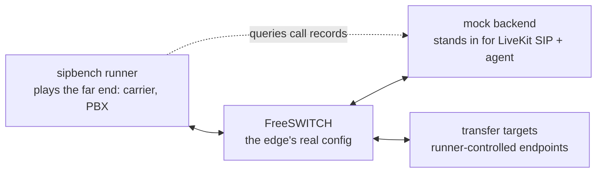

# freeswitch-operator

A Kubernetes operator for running a fleet of FreeSWITCH nodes as a SIP edge (an SBC) behind a Kamailio proxy, plus
**sipbench**, a SIP test bench that proves every call flow against that edge before real traffic moves onto it.

> **Status: early, under construction (v0).** The API is `v1alpha1` and will change. Nothing here has carried a
> production call yet. The plan below is the design we are building toward; the [milestones](#milestones) say what
> exists today.

## Why this exists

FreeSWITCH runs well on Kubernetes once a few non-default things are true, and every team that does it rebuilds
the same pieces by hand:

- **Media needs the node's own network.** Overlay pod networking breaks RTP: signaling succeeds and audio silently
  fails. FreeSWITCH has to run with `hostNetwork: true` and a planned RTP port range, which means one FreeSWITCH
  pod per node.
- **Peers need fixed public addresses.** Carriers and customer PBXs allow-list our IPs, for signaling and often
  for media, in both directions. A pod on the host network uses its node's address, and nodes are replaced all the
  time (upgrades, node expiry, failures). A network load balancer covers inbound signaling only: a request we
  originate leaves from the node's own address, and RTP can't pass through it at all.
- **Calls last minutes; the defaults assume seconds.** A node must stop taking new calls, let its live calls
  finish, and only then go away. That has to hold for rolling updates, node drains and autoscaler consolidation.
- **The proxy in front has to know who can take a call.** Kamailio's dispatcher list must follow the fleet as
  nodes join, drain and leave.
- **Call recovery is an address move.** FreeSWITCH can resume a failed node's tracked calls on another node, but
  only if the far end's packets still arrive, which means the failed node's address moves with its calls, and
  the failed node must never hold it again (no split brain).

## Architecture


- **Kamailio** holds the fixed signaling addresses and spreads new calls across FreeSWITCH nodes with its
  dispatcher module. It sees every node through the operator.
- **FreeSWITCH** ends every trunk, anchors media and applies per-trunk policy (transfers, codecs, headers). Each
  node runs on the host network, one per node, with its RTP range open in the node's security group.
- **The operator** owns the FreeSWITCH pods and everything around them: the headless service, the dispatcher list,
  each node's public address, drains, rolling updates, and (from v1) failover.
- **Behind the edge**, FreeSWITCH bridges calls to a SIP target. In the bench that is sipbench's mock backend; later
  it is LiveKit SIP, and through it the agent runtime.

## The `FreeswitchCluster` resource

One resource describes one fleet. A sketch of where the API is heading (fields marked *v0* exist today; the rest
are planned):

```yaml
apiVersion: sip.instruments.com/v1alpha1
kind: FreeswitchCluster
metadata:
  name: edge
  namespace: telephony
spec:
  replicas: 3                       # v0. One pod per node; keep one spare for updates and failover
  image: registry.example.com/freeswitch:1.10.12-1   # v0. Must contain freeswitch and fs_cli
  nodeSelector:                     # v0. Pin to the edge node group
    node-role.example.com/sip-edge: "true"
  tolerations: []                   # v0
  sip:
    port: 5060                      # v0. The profile Kamailio dispatches to
  rtp:
    portRangeStart: 16384           # v0. Must match the node security group
    portRangeEnd: 32768
  externalAddress:
    source: NodeExternalIP          # v0: NodeExternalIP | None. Planned: AddressPool
    # addressPoolRef: {name: edge-addresses}   # planned (M3)
  config:
    configMapRefs:                  # v0. Mounted read-only under /etc/freeswitch-operator/config/<name>
      - name: edge-freeswitch-config
  drain:
    maxDrainSeconds: 7200           # v0. Upper bound on waiting for live calls to finish
  dispatcher:
    setID: 1                        # v0. Kamailio dispatcher set for this fleet
    configMapName: edge-dispatcher  # v0. The operator writes dispatcher.list here
    jsonrpcURL: ""                  # v0, optional. Kamailio JSON-RPC endpoint for immediate state changes
status:
  readyReplicas: 2
  members:                          # v0. One entry per pod
    - pod: edge-0
      node: ip-10-0-1-23
      address: 10.0.1.23            # what Kamailio dispatches to (the node's private address)
      externalAddress: 203.0.113.10 # what peers see
      state: Active                 # Starting | Active | Draining
  currentRevision: edge-7c9d…
  updateRevision: edge-7c9d…
  conditions: []
```

## Control loops

Each loop is small and does one thing. Numbering matches the order we build them.

### 1. Fleet: pods, service and disruption budget (v0)

The operator renders a StatefulSet with:
- `hostNetwork: true` and `dnsPolicy: ClusterFirstWithHostNet`, so the pod uses the node's network but can still
  resolve cluster services;
- a required pod anti-affinity on the hostname, so there is never more than one FreeSWITCH per node (ports clash
  otherwise);
- `updateStrategy: OnDelete`, so the operator, not the StatefulSet controller, decides when a pod is replaced;
- `terminationGracePeriodSeconds` set from `drain.maxDrainSeconds`, so a draining pod is not killed early;
- a `preStop` hook and a readiness probe from scripts the operator ships in a ConfigMap (below), so any image with
  `freeswitch` and `fs_cli` works;
- a downward-API volume of the pod's annotations, through which the operator hands the pod its external address
  (loop 4).

It also creates a headless Service selecting the pods (readiness decides membership) and a PodDisruptionBudget
with `maxUnavailable: 1`.

### 2. Dispatcher membership (v0)

**The headless service's EndpointSlices are the source of truth: a ready endpoint takes new calls.** The operator
watches them and:
1. renders Kamailio's `dispatcher.list` (one line per ready node, set `dispatcher.setID`) into the ConfigMap named
   by `dispatcher.configMapName`; Kamailio mounts it;
2. if `dispatcher.jsonrpcURL` is set, calls Kamailio's JSON-RPC: `dispatcher.set_state` to take a draining node out
   immediately, then `dispatcher.reload` once the new list is on disk.

Why not DNS discovery alone: DNS adds lag (TTL plus Kamailio's re-resolve interval), and a single headless-service
name is a single dispatcher destination rather than one per pod. Why not a Reloader annotation: that does a rolling
restart of Kamailio, which drops in-flight transactions to absorb a membership change. A mounted ConfigMap reaches
the file within about a minute (never use `subPath`; it never updates), and the reload is a runtime call.

Kamailio's own OPTIONS probing (`ds_ping_interval`) stays on as a backstop, and FreeSWITCH answers new calls with
`503` while paused, so dispatcher fails over on a `503` during the gap between "not ready" and "Kamailio knows".

### 3. Drains and rolling updates (v0)

**One mechanism serves both: a pod is drained by deleting it, and its `preStop` hook does the waiting.**
- `preStop` marks the pod as draining (readiness fails at once, so loop 2 removes it from dispatch), runs
  `fsctl pause inbound`, and waits until `show calls count` reaches zero or `maxDrainSeconds` passes.
- **Rolling update:** when the pod template changes, the operator replaces one pod at a time, only while every
  other pod is ready and none is terminating: delete, wait for the replacement to pass readiness, move on.
- **Node drain, autoscaler consolidation or node expiry:** eviction respects the PodDisruptionBudget, and the same
  `preStop` drain runs under the same long grace period. (Planned: the operator sets `karpenter.sh/do-not-disrupt`
  on pods with live calls; to be verified against EKS Auto Mode before we rely on it.)
- **Keep a spare.** With one pod per node, an update without a spare runs a node short for its whole length.

### 4. External addresses (v0 node addresses; pool in M3)

FreeSWITCH must put its public address in SDP and SIP headers (`ext-rtp-ip`, `ext-sip-ip`). The operator writes it
on each pod as the annotation `sip.instruments.com/external-address`; the pod reads it from its downward-API
volume, which, unlike environment variables, updates in place. The bundled `vars.xml` example uses FreeSWITCH's
`exec-set` pre-processor to read it at start.
- **v0, `source: NodeExternalIP`:** the address comes from the node's `ExternalIP`.
- **M3, `source: AddressPool`:** a separate `SIPAddressPool` resource holds a fixed list of addresses (AWS Elastic
  IPs first, through a provider interface) and binds one to each edge node, Kamailio's and FreeSWITCH's alike. When
  a node is replaced, its address moves to the replacement. One spare node and one spare address are the norm.

### 5. Failover with fencing (v1, M4)

When a node dies mid-call: fence it (its address is disassociated before anything else happens), move its address
to the spare, and have the spare run `sofia recover` against the shared call-tracking database (`track-calls` on the
SIP profiles, PostgreSQL behind). This is the riskiest loop and the most valuable, so it comes after sipbench can
kill a node mid-call and check the outcome. Until then a node's calls drop when it dies, and new calls go elsewhere.

### 6. Configuration from git (v0 mounting; M5 typed)

v0 mounts ConfigMaps (dial plan, ACLs, profiles) that Flux applies from git, and a change rolls the fleet through
loop 3. Later, typed resources for trunks and ACLs, reloaded with `reloadxml` and `reloadacl` without a restart.

## sipbench: the SIP test bench

**sipbench proves call flows end to end through a real FreeSWITCH, with configurable mocks behind it, so each layer
can be swapped for the real thing as it is built.** It lives in [`sipbench/`](sipbench/) as its own Go module.



- **The runner** places calls into FreeSWITCH as a carrier or PBX would: headers, codecs, keypad tones, CANCEL, and
  it listens for test tones to prove two-way audio. It also answers as a transfer target.
- **The mock backend** answers what FreeSWITCH bridges to, with behaviour chosen per called number from a YAML file:
  ring, reject with a code, answer, play a tone, send keypad tones, ask for a blind transfer, hang up. It records
  what it received (headers, codecs, digits, audio) for the runner to check.
- **Backends are pluggable.** A scenario names the capabilities it needs. Today only `mock` exists; `livekit-sip`
  (LiveKit SIP with a scripted agent) and `runtime` (the real agent runtime) plug in behind the same FreeSWITCH
  config as those layers exist, and scenarios that need them stop skipping.
- **Each run checks** the SIP ladder (expected messages in order), media in both directions, digits sent equal digits
  received, the outcome (who answered, legs released), and timings.

Scenario coverage, by area (what a software harness can prove; carrier- and vendor-specific behaviour is proven on
real trunks):

| Area | Scenarios |
| --- | --- |
| Basic calls | inbound answered, two-way tone, caller hangs up, backend hangs up, CANCEL before answer |
| Failures | busy, no answer after the ring timeout, `603`, unreachable backend; the caller gets the fallback |
| Headers | `X-` headers on the INVITE reach the backend; a conversation id rides every transfer |
| Transfers | blind transfer asked for by the backend (REFER), ended at the edge and placed by FreeSWITCH, or passed on |
| Keypad tones | RFC 2833 both ways; SIP INFO and in-band converted to RFC 2833 |
| Codecs | G.711 µ-law and A-law, G.722 toward the backend |
| Admission | calls beyond the limit get the fallback; OPTIONS answered |
| Fleet (on a cluster) | a node drained mid-call keeps its calls; a node killed mid-call; rolling update with live calls |

See [`sipbench/README.md`](sipbench/README.md) for how to run it.

## GitOps with Flux

Clusters are managed with Flux. This repository publishes what a cluster needs; a separate fleet repository says
which version runs where.

- **This repository** builds and publishes the operator image and the CRDs and manager manifests as a Kustomize
  base (`config/`), and an example of the Flux objects that consume them ([`deploy/flux/`](deploy/flux/)).
- **The fleet repository** (one per organisation) holds `clusters/<name>/` with a Flux `GitRepository` or
  `OCIRepository` pointing here at a tag, a `Kustomization` for the operator, and the `FreeswitchCluster`,
  FreeSWITCH config ConfigMaps and Kamailio for that cluster. Promotion from QA to production is a pull request
  that moves a tag.
- **Builds** run in the CI system of whoever hosts this repository; the pipeline runs `make test`, the bench, and
  publishes the image. Flux image automation can propose tag bumps to the fleet repository.

## Milestones

| | Milestone | State |
| --- | --- | --- |
| M0 | Repository, plan, operator scaffold, sipbench mock backend and runner running against FreeSWITCH in Docker | in progress |
| M1 | v0 operator on kind: fleet, dispatcher list, drains and rolling updates; sipbench runs against it | in progress |
| M2 | sipbench fleet scenarios on a cluster: drain mid-call, rolling update with live calls | planned |
| M3 | `SIPAddressPool` with an AWS Elastic IP provider; edge node group on EKS | planned |
| M4 | v1 failover with fencing and call recovery | planned |
| M5 | Typed trunk and ACL resources; reload without restart | planned |
| M6 | Publish as open source, once it has carried production calls | planned |

## Development

Prerequisites: Go 1.26+, Docker, kind, kubectl. Kubebuilder v4 scaffolded this project; `make` installs the rest
of the tools it needs into `./bin`.

```sh
make test            # unit and envtest-based controller tests
make manifests       # regenerate CRDs and RBAC after changing api/ or markers
make run             # run the controller against your current kubeconfig
make docker-build IMG=<registry>/freeswitch-operator:<tag>
```

sipbench has its own instructions in [`sipbench/README.md`](sipbench/README.md).

## Open questions

1. **Does the operator also run Kamailio?** v0 drives a Kamailio it doesn't own. Owning it would let one resource
   describe the whole edge, at the cost of a second, larger API.
2. **rtpengine beside Kamailio, or fixed addresses on every FreeSWITCH node?** It depends on whether peers
   allow-list media addresses. Fixed addresses on FreeSWITCH nodes are simpler; rtpengine keeps FreeSWITCH
   private.
3. **Where do registrations live?** Registering to a carrier ties a registration to one address. It should be one
   designated node, or Kamailio.
4. **Licence and publishing.** Apache 2.0 is the likely choice; the decision to publish, and when, is the owners'.
5. **The FreeSWITCH image.** We build and maintain our own; packages from SignalWire need a token.

## Licence

Not yet decided; see open question 4. Until then this is internal code.
