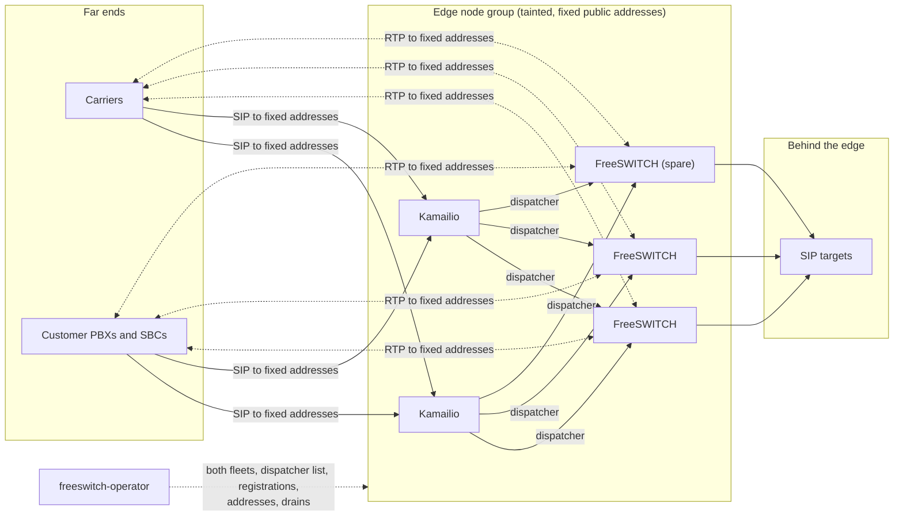
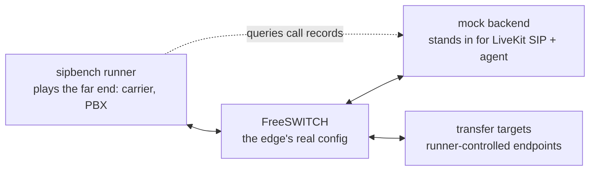

# freeSWITCH Operator

A Kubernetes operator for running a fleet of FreeSWITCH nodes as a SIP edge (an SBC) behind a Kamailio proxy, plus
**sipbench**, a SIP test bench that call flows against that edge before real traffic moves onto it.

> **Status: early, under construction (v0).** The API is `v1alpha1` and will change. The plan below is the design we
> are building toward; the [milestones](#milestones) describe what is in place today.

## Why this exists

FreeSWITCH runs well on Kubernetes once a few non-default things are true, and every team that does it must rebuild
the same pieces by hand:

- **Media needs the node's own network.** Overlay pod networking breaks RTP: signaling succeeds and audio silently
  fails. FreeSWITCH has to run with `hostNetwork: true` and a planned RTP port range, which means one FreeSWITCH
  pod per node.
- **Peers need fixed public addresses.** Carriers and customer PBXs allow-list our IPs, for signaling and often
  for media, in both directions. A pod on the host network uses its node's address, and nodes are replaced all the
  time (upgrades, node expiry, failures). A network load balancer covers inbound signaling only: a request we
  originate leaves from the node's own address, and RTP can't pass through it at all.
- **Calls last minutes; the defaults assume seconds.** A node must stop taking new calls, let its live calls
  finish, and only then go away. That has to hold for rolling updates, node drains and autoscaler consolidation.
- **The proxy in front has to know who can take a call.** Kamailio's dispatcher list must follow the fleet as
  nodes join, drain and leave.
- **Call recovery is an address move.** FreeSWITCH can resume a failed node's tracked calls on another node, but
  only if the far end's packets still arrive, which means the failed node's address moves with its calls, and
  the failed node must never hold it again (no split brain).

## Architecture



- **Kamailio** holds the fixed signaling addresses, registers to carriers that need it, and spreads new calls
  across FreeSWITCH nodes with its dispatcher module. The operator runs it as a managed resource
  ([`KamailioCluster`](#7-kamailio-as-a-managed-resource-m2)).
- **FreeSWITCH** ends every call leg, anchors media and runs the call: bridging, transfers, codecs, headers.
  Per-peer policy isn't kept here; it is data in the Kamailio fleet ([loop 9](#9-per-peer-behaviour-m5)). Each
  node runs on the host network, one per node, with its RTP range open in the node's security group, and advertises
  its own fixed public address for media. No media relay sits in front of it; rtpengine beside Kamailio stays an
  option for later (see [Decisions](#decisions)).
- **The operator** owns both fleets and everything around them: the headless services, the dispatcher list,
  outbound registrations, each node's public address, drains, rolling updates, and (from v1) failover.
- **Behind the edge**, FreeSWITCH bridges calls to a SIP target. In the bench that is sipbench's mock backend; later
  it is LiveKit SIP, and through it the agent runtime.

## The `FreeswitchCluster` resource

One resource describes one fleet. A sketch of where the API is heading (fields marked *v0* exist today; the rest
are planned):

```yaml
apiVersion: sip.instruments.com/v1alpha1
kind: FreeswitchCluster
metadata:
  name: edge
  namespace: telephony
spec:
  replicas: 3                       # v0. One pod per node; keep one spare for updates and failover
  image: drachtio/drachtio-freeswitch-mrf:0.9.6     # pin by digest; must contain freeswitch and fs_cli
  nodeSelector:                     # v0. Pin to the edge node group
    node-role.example.com/sip-edge: "true"
  tolerations: []                   # v0
  sip:
    port: 5060                      # v0. The profile Kamailio dispatches to
  rtp:
    portRangeStart: 16384           # v0. Must match the node security group
    portRangeEnd: 32768
  externalAddress:
    source: NodeExternalIP          # v0: NodeExternalIP | None. Planned: AddressPool
    # addressPoolRef: {name: edge-addresses}   # planned (M3)
  config:
    mountPath: /usr/local/freeswitch/conf   # v0. Point FreeSWITCH here with -conf
    configMapRefs:                  # v0. Each ConfigMap's keys become files in its directory; an edit rolls the fleet
      - {name: edge-freeswitch-conf, path: "."}
      - {name: edge-freeswitch-profiles, path: sip_profiles}
  drain:
    maxDrainSeconds: 7200           # v0. Upper bound on waiting for live calls to finish
  dispatcher:
    setID: 1                        # v0. Kamailio dispatcher set for this fleet
    configMapName: edge-dispatcher  # v0. The operator writes dispatcher.list here
    jsonrpcURL: ""                  # v0, optional. Kamailio JSON-RPC endpoint (port 5070 in the example)
status:
  readyReplicas: 2
  members:                          # v0. One entry per pod
    - pod: edge-0
      node: ip-10-0-1-23
      address: 10.0.1.23            # what Kamailio dispatches to (the node's private address)
      externalAddress: 203.0.113.10 # what peers see
      state: Active                 # Starting | Active | Draining
  currentRevision: edge-7c9d…
  updateRevision: edge-7c9d…
  conditions: []
```

## Control loops

Each loop is small and does one thing. Numbering matches the order we build them.

### 1. Fleet: pods, service and disruption budget (v0)

The operator renders a StatefulSet with:
- `hostNetwork: true` and `dnsPolicy: ClusterFirstWithHostNet`, so the pod uses the node's network but can still
  resolve cluster services;
- a required pod anti-affinity on the hostname, so there is never more than one FreeSWITCH per node (ports clash
  otherwise);
- `updateStrategy: OnDelete`, so the operator, not the StatefulSet controller, decides when a pod is replaced;
- `terminationGracePeriodSeconds` set from `drain.maxDrainSeconds`, so a draining pod is not killed early;
- a `preStop` hook, a startup probe and a readiness probe from scripts the operator ships in a ConfigMap (below),
  so any image with `freeswitch` and `fs_cli` works. **Startup** passes once FreeSWITCH is ready with a SIP profile
  running on `sip.port`, the port Kamailio sends to; FreeSWITCH calls itself ready even with no profile loaded. A pod
  that doesn't get there within two minutes is restarted, which costs nothing: it has never been ready, so it holds
  no calls. **Readiness** adds "not draining" and, when required, "knows its external address", and keeps
  re-checking the profile, so a profile that stops later takes the node out of dispatch without touching its calls.
  **No liveness probe:** a failure restarts the container and drops every call on the node, and `fs_cli` can be
  slow under load, so a false positive at peak would do more harm than the hang it guards against. A crash needs no
  probe, since the process exits and the container restarts. (Opt-in hang detection with a lax default is planned
  for M2.)
- a downward-API volume of the pod's annotations, through which the operator hands the pod its external address
  (loop 4).

It also creates a headless Service selecting the pods (readiness decides membership) and a PodDisruptionBudget
with `maxUnavailable: 1`.

### 2. Dispatcher membership (v0)

**The headless service's EndpointSlices are the source of truth: a ready endpoint takes new calls.** The operator
watches them and:
1. renders Kamailio's `dispatcher.list` (one line per ready node, set `dispatcher.setID`) into the ConfigMap named
   by `dispatcher.configMapName`; Kamailio mounts it;
2. if `dispatcher.jsonrpcURL` is set, calls Kamailio's JSON-RPC: `dispatcher.set_state` to take a draining node out
   immediately, then `dispatcher.reload` once the new list is on disk.

Kamailio's own OPTIONS probing (`ds_ping_interval`) stays on as a backstop, and FreeSWITCH answers new calls with
`503` while paused, so dispatcher fails over on a `503` during the gap between "not ready" and "Kamailio knows".

### 3. Drains and rolling updates (v0)

**One mechanism serves both: a pod is drained by deleting it, and its `preStop` hook does the waiting.**
- `preStop` marks the pod as draining (readiness fails at once, so loop 2 removes it from dispatch), runs
  `fsctl pause inbound`, and waits until `show calls count` reaches zero or `maxDrainSeconds` passes.
- **Rolling update:** when the pod template changes, the operator replaces one pod at a time, only while every
  other pod is ready and none is terminating: delete, wait for the replacement to pass readiness, move on. A
  replacement that never gets its SIP profile up stops the roll there, with the rest of the fleet still serving.
- **Node drain, autoscaler consolidation or node expiry:** eviction respects the PodDisruptionBudget, and the same
  `preStop` drain runs under the same long grace period. (Planned: the operator sets `karpenter.sh/do-not-disrupt`
  on pods with live calls; to be verified against EKS Auto Mode before we rely on it.)
- **Keep a spare.** With one pod per node, an update without a spare runs a node short for its whole length.

### 4. External addresses (v0 node addresses; pool in M3)

FreeSWITCH must put its public address in SDP and SIP headers (`ext-rtp-ip`, `ext-sip-ip`). The operator writes it
on each pod as the annotation `sip.instruments.com/external-address`; the pod reads it from its downward-API
volume, which, unlike environment variables, updates in place. The bundled `vars.xml` example uses FreeSWITCH's
`exec-set` pre-processor to read it at start.
- **v0, `source: NodeExternalIP`:** the address comes from the node's `ExternalIP`.
- **M3, `source: AddressPool`:** a separate `SIPAddressPool` resource holds a fixed list of addresses (AWS Elastic
  IPs first, through a provider interface) and binds one to each edge node, Kamailio's and FreeSWITCH's alike. When
  a node is replaced, its address moves to the replacement. One spare node and one spare address are the norm.

### 5. Failover with fencing (v1, M4)

When a node dies mid-call: fence it (its address is disassociated before anything else happens), move its address
to the spare, and have the spare run `sofia recover` against the shared call-tracking database (`track-calls` on the
SIP profiles, PostgreSQL behind). This is the riskiest loop and the most valuable, so it comes after sipbench can
kill a node mid-call and check the outcome. Until then a node's calls drop when it dies, and new calls go elsewhere.

### 6. Configuration from git (v0 mounting; M5 typed)

v0 assembles FreeSWITCH's configuration directory from ConfigMaps that Flux applies from git. Each reference names a
directory under `config.mountPath` (`.` for the top, `autoload_configs`, `sip_profiles`, ...), and the operator lays
the ConfigMaps' keys out there as one read-only projected volume, so a whole tree like FreeSWITCH's own fits. Pods
never mount the ConfigMaps themselves: the kubelet would push an edit into every running pod within a minute, ahead
of any drain. The operator copies each one into an immutable ConfigMap named by a hash of its contents
(`<cluster>-config-<hash>`), and each revision of the pod template mounts its own copies. An edit therefore makes a
new template, which loop 3 rolls through one drained node at a time, while pods not yet replaced keep the files they
started with. Copies no template or pod uses any more are deleted. A missing or empty ConfigMap, or two claiming
the same path, marks the fleet `Degraded`, leaves the running pods alone and pauses any roll in progress. (An empty
one is nearly always an accident, and rolling it out could remove a whole directory, such as every SIP profile; to
ship an empty directory on purpose, drop the reference.)
In M5, typed resources take over, each reloaded where it lives. Peer resources (loop 9) render into the Kamailio
fleet and reload over its JSON-RPC. FreeSWITCH keeps only its own config (profiles, and the ACL of who may reach
it), reloaded with `reloadxml` and `reloadacl`.

### 7. Kamailio as a managed resource (M2)

A `KamailioCluster` runs the proxy fleet the same way a `FreeswitchCluster` runs the media fleet: one pod per edge
node on the host network, a fixed public address each, and the operator in charge of its config. It names the
`FreeswitchCluster`s it dispatches to, one dispatcher set each.

- **Config:** the operator renders `kamailio.cfg` from a template (dispatcher routing with failover on `503` or no
  answer, JSON-RPC on an internal port, as in [`deploy/examples/kamailio`](deploy/examples/kamailio/)), plus the
  dispatcher list. Peer data (loop 9) and registrations (loop 8) join it in M5.
- **Membership changes reach every Kamailio pod.** The operator calls each pod's JSON-RPC directly, rather than
  one Service name that reaches only one of them.
- **JSON-RPC is authenticated.** Kamailio's JSON-RPC has no authentication of its own, and NetworkPolicy doesn't
  apply to host-network pods. So the operator keeps a token in a Secret and the pods get it as an environment
  variable. The HTTP route refuses any request without that token. The RPC listener binds to the node's private
  address only, and the security group allows it only from the operator's subnet.
- **Most changes are live; a short list restarts.** Changes reach the fleet over JSON-RPC unless they touch a field
  on the restart list: listening addresses and ports, loaded modules and their parameters, and the routing script.
  A change to one of those rolls the fleet one pod at a time, which is cheap because a Kamailio drain is short. The
  operator keeps that list rather than a list of what reloads, since everything not on it reloads.
- **Updates and drains:** Kamailio holds transactions, not calls, so a drain is short: stop taking new requests,
  let transactions finish, stop. From M5, a pod that holds registrations hands them over first (loop 8).
- **One Kamailio fleet by default.** Per-peer behaviour is data in that fleet (loop 9), not a fleet per peer. Because
  a `FreeswitchCluster` publishes its membership as a ConfigMap, more than one `KamailioCluster` can dispatch to the
  same FreeSWITCH fleet. That is for isolation: a lane whose bad config or overload can't reach the other, or that
  upgrades on its own schedule. Behaviour alone isn't a reason for one, and neither is a peer on the inside network
  (loop 10 covers those in the one fleet).
- The example in `deploy/examples/kamailio` becomes the template once this lands; until then, it is how v0 is run.

### 8. Outbound registrations (M5, when a peer needs them)

Some carriers send inbound calls only to an address that has registered for the number, with a username and
password. The registration names one address (its `Contact`), so it belongs on the proxy, whose address is fixed,
not on a FreeSWITCH node that can drain or die. Many peers don't register at all: they recognise the edge by its
source address, or challenge each call. So this loop is built when the first peer needs it, as a field of that
peer (loop 9).
- Kamailio's `uac` module registers for each configured number and re-registers before expiry; the carrier then
  sends calls to Kamailio, which dispatches them like any other.
- Credentials come from a Kubernetes Secret; the operator renders the registrations table and reloads it over
  JSON-RPC.
- **Registration mode is per peer**, because carriers treat several contacts for one number differently: some
  try each one, some keep only the latest, some reject the second.
  - `single` (the default) registers from one Kamailio pod. When that pod drains, the operator moves the
    registration to another pod in the order that carrier accepts. Either it registers the new contact first and
    then removes the old one, or it removes the old one first and accepts a short gap. sipbench's registrar mocks
    and a test call decide which order a carrier needs. If the registering pod fails instead of draining, the
    operator registers from another pod as soon as it sees the pod isn't ready. Registrations use a short expiry,
    so a carrier stops sending to a dead contact soon, even if nothing re-registers.
  - `perReplica` registers from every pod, so the carrier can fail over by itself. It's turned on per peer, once
    sipbench and a test call against that carrier show it accepts several contacts.

### 9. Per-peer behaviour (M5)

Each peer (a carrier, a voice AI provider, a customer PBX) needs its own handling at the edge. A typed peer
resource carries it, and the operator renders it into the Kamailio fleet's config. No route block is written per
peer. Behaviours peers need in practice, and the Kamailio feature that covers each one:

| Peer needs | Kamailio |
| --- | --- |
| Recognise the peer by its source address | `permissions` address table: address to peer tag |
| Several signaling addresses for one peer, each with its own health checks (some peers want none) | A dispatcher set per peer; the operator marks which destinations to probe (below) |
| A fixed Request-URI host (its termination hostname); numbers in E.164 | Per-peer rewrite rules (`dialplan` module) |
| A digest challenge the edge answers itself, rather than passing it back to the caller | `uac_auth()` with the peer's credentials, from a Secret |
| REFER handled at the edge, or passed on to the peer | Per-peer flag, sent to FreeSWITCH in a header (below) |
| Reached on the inside network (a VPN), with no NAT | Loop 10 |
| Inbound calls only after registering | Loop 8 |

- **Reloads.** Peer data lives in `db_text` tables the operator renders: `permissions` addresses, `dialplan` rules,
  `uac` registrations, and an `htable` for per-peer flags and digest credentials. Each reloads over JSON-RPC.
  `uac_auth()` reads credentials from AVPs filled from that table, not from the static `credential` parameter. The
  module docs don't fully settle whether that works without the parameter, so sipbench's challenging peer mock
  confirms it, and confirms that `db_text` serves each module, before M5 relies on them. Nothing here is on the
  restart list (loop 7).
- **Health checks are per destination.** The template runs `ds_probing_mode 3`, which keeps probing only the
  destinations that carry the probing flag (`8`) in the dispatcher list. The operator sets that flag on every
  FreeSWITCH node, and on a peer's destinations unless that peer asked for no health checks. (The v0 example probes
  every destination with mode 1; the M2 template switches.)
- **Dispatcher set IDs don't collide.** A fleet's `spec.dispatcher.setID` stays the user's choice, limited to 1–99.
  Sets the operator creates (a peer's, or a fleet's inside set from loop 10) take IDs from 100 up, recorded in the
  owning resource's status. From M2 the operator renders the whole list, so a collision becomes a condition instead
  of one set overwriting another.
- **What FreeSWITCH needs to know travels in headers.** Kamailio removes any `X-Edge-*` header a peer sent, so a
  peer can't forge one. It then adds the peer's tag (`X-Edge-Peer`) and the flags FreeSWITCH acts on, such as
  `X-Edge-Refer: edge|pass`. FreeSWITCH's dialplan reads them. With `edge`, it sets `force_transfer_context` and
  places the transfer itself, as sipbench does today. With `pass`, it passes the REFER on to the peer.

### 10. Peers on the inside network (M6)

Some peers reach the edge over a VPN into the VPC rather than over the internet, with no NAT on either side. For
them, both fleets have to use the nodes' internal addresses, for signaling and media alike. The public address that
FreeSWITCH advertises (loop 4) would send their RTP somewhere they can't reach.
- **FreeSWITCH:** a second SIP profile on the node's private address, advertising that address in SDP (no
  `ext-rtp-ip`). The operator publishes the fleet's members on that profile as a second dispatcher set.
- **Kamailio:** an inside listening address beside the public one. For an inside peer, Kamailio sends from it and
  dispatches to the fleet's inside set. A new listening address is on the restart list (loop 7), so adding one
  rolls the fleet; attaching the address touches the node anyway.
- **Network:** the VPN routes to the edge node subnet, and the security group opens SIP and the RTP range to the
  peer's networks. Peers allow-list the subnet, not node addresses, since nodes are replaced.
- **sipbench:** a peer mock on a second network checks that the SDP it receives carries an inside address and that
  audio flows both ways.

## sipbench: the SIP test bench

**sipbench proves call flows end to end through a real FreeSWITCH, with configurable mocks behind it, so each layer
can be swapped for the real thing as it is built.** It lives in [`sipbench/`](sipbench/) as its own Go module.



- **The runner** places calls into FreeSWITCH as a carrier or PBX would: headers, codecs, keypad tones, CANCEL, and
  it listens for test tones to prove two-way audio. It also answers as a transfer target.
- **The mock backend** answers what FreeSWITCH bridges to, with behaviour chosen per called number from a YAML file:
  ring, reject with a code, answer, play a tone, send keypad tones, ask for a blind transfer, hang up. It records
  what it received (headers, codecs, digits, audio) for the runner to check.
- **Backends are pluggable.** A scenario names the capabilities it needs. Today only `mock` exists; `livekit-sip`
  (LiveKit SIP with a scripted agent) and `runtime` (the real agent runtime) plug in behind the same FreeSWITCH
  config as those layers exist, and scenarios that need them stop skipping.
- **Each run checks** the SIP ladder (expected messages in order), media in both directions, digits sent equal digits
  received, the outcome (who answered, legs released), and timings.

Scenario coverage, by area (what a software harness can prove; carrier- and vendor-specific behaviour is proven on
real trunks):

| Area | Scenarios |
| --- | --- |
| Basic calls | inbound answered, two-way tone, caller hangs up, backend hangs up, CANCEL before answer |
| Failures | busy, no answer after the ring timeout, `603`, unreachable backend; the caller gets the fallback |
| Headers | `X-` headers on the INVITE reach the backend; a conversation id rides every transfer |
| Transfers | blind transfer asked for by the backend (REFER), ended at the edge and placed by FreeSWITCH, or passed on |
| Keypad tones | RFC 2833 both ways; SIP INFO and in-band converted to RFC 2833 |
| Codecs | G.711 µ-law and A-law, G.722 toward the backend |
| Admission | calls beyond the limit get the fallback; OPTIONS answered |
| Fleet (on a cluster) | a node drained mid-call keeps its calls; a node killed mid-call; rolling update with live calls |
| Peers (planned, through Kamailio) | peer mocks in front of the proxy: one that rejects a wrong Request-URI host or a non-E.164 number, one that challenges each call, and a registrar that tries every contact, keeps only the latest, or rejects the second |

See [`sipbench/README.md`](sipbench/README.md) for how to run it.

## GitOps with Flux

Clusters may be managed with Flux and other Gitops tools. This repository publishes what a cluster needs; a separate fleet repository says
which version runs where.

- **This repository** builds and publishes the operator image and the CRDs and manager manifests as a Kustomize
  base (`config/`), and an example of the Flux objects that consume them ([`deploy/flux/`](deploy/flux/)).
- **The fleet repository** (one per organization) holds `clusters/<name>/` with a Flux `GitRepository` or
  `OCIRepository` pointing here at a tag, a `Kustomization` for the operator, and the `FreeswitchCluster`,
  FreeSWITCH config ConfigMaps and Kamailio for that cluster. Promotion from QA to production is a pull request
  that moves a tag.
- **Builds** run in the CI system of whoever hosts this repository; the pipeline runs `make test`, the bench, and
  publishes the image. Flux image automation can propose tag bumps to the fleet repository.

## Milestones

| | Milestone | State |
| --- | --- | --- |
| M0 | Repository, plan, operator scaffold, sipbench mock backend and runner running against FreeSWITCH in Docker | done |
| M1 | v0 operator on kind: fleet, dispatcher list, drains and rolling updates; sipbench runs against it ([how](#the-edge-on-kind)) | done |
| M2 | `KamailioCluster`: managed Kamailio, dispatcher changes to every pod over authenticated JSON-RPC, restart list; sipbench fleet scenarios (drain mid-call, rolling update with live calls, run as scenarios rather than by hand), with call records kept per run so concurrent runners don't clear each other's; opt-in liveness (hang detection) with a lax default | planned |
| M3 | `SIPAddressPool` with an AWS Elastic IP provider, shared by both fleets; edge node group on EKS | planned |
| M4 | v1 failover with fencing and call recovery | planned |
| M5 | Typed peer and ACL resources (loop 9), outbound registrations when a peer needs them (loop 8), sipbench peer mocks; reload without restart | planned |
| M6 | Peers on the inside network (loop 10): FreeSWITCH inside profile and dispatcher set, Kamailio inside listener, sipbench VPN peer mock | planned |
| M7 | Publish as open source, once it has carried production calls | planned |

## Development

Prerequisites: Go 1.26+, Docker, kind, kubectl. Kubebuilder v4 scaffolded this project; `make` installs the rest
of the tools it needs into `./bin`.

```sh
make test            # unit and envtest-based controller tests
make manifests       # regenerate CRDs and RBAC after changing api/ or markers
make run             # run the controller against your current kubeconfig
make docker-build IMG=<registry>/freeswitch-operator:<tag>
```

sipbench has its own instructions in [`sipbench/README.md`](sipbench/README.md).

### The edge on kind

[`hack/kind.sh`](hack/kind.sh) runs the whole edge locally: a kind cluster with two proxy nodes and three tainted
edge nodes ([`deploy/kind`](deploy/kind/)), the operator built from this tree, Kamailio from
[`deploy/examples/kamailio`](deploy/examples/kamailio/), a three-node `FreeswitchCluster` running sipbench's
FreeSWITCH configuration, and sipbench's mock backend behind it.

```sh
make kind-up         # create the cluster (about 6 GB of Docker memory)
make kind-deploy     # build and load the images, install the operator, apply deploy/kind, wait for the fleet
make kind-bench      # run sipbench through Kamailio; hack/kind.sh bench <regexp> runs a subset
hack/kind.sh status  # members, the dispatcher list, and what each Kamailio has loaded
make kind-down
```

Through Kamailio the bench passes everything but `codec-g722` (the image has no G.722) and `admission-limit` (it
needs the event socket of one particular node). M1 was also checked by hand on this cluster:

- **Rolling update with a live call:** the call on the first pod to be replaced kept two-way audio while that pod
  drained, the operator held the other two until it finished, then replaced them one at a time.
- **Node drain with a live call:** `kubectl drain` on the call's node made its pod unready and took it out of the
  dispatcher list at once; a new call placed meanwhile went to another node; the drain finished when the call ended.
- **Config change:** editing a referenced ConfigMap made a new snapshot and rolled the fleet one node at a time
  (about 35 s). Pods not yet replaced never saw the edit, and the old snapshot was deleted once no pod used it.

## Decisions

1. **The operator runs a Kamailio proxy**, as a `KamailioCluster` resource ([loop 7](#7-kamailio-as-a-managed-resource-m2)).
   One operator describes the whole edge.
2. **Media relay deferred for now: each FreeSWITCH node advertises its own fixed public address.** In the Kamailio and
   FreeSWITCH communities, rtpengine may be used when FreeSWITCH must stay on private addresses or media needs per-direction
   control. FreeSWITCH already anchors media, so it only needs a routable address it can advertise (`ext-rtp-ip`). `rtpengine`
   maybe be added later as needed.
4. **Registrations live on Kamailio** ([loop 8](#8-outbound-registrations-m5-when-a-peer-needs-them)), whose
   address is fixed, with the mode chosen per peer: one pod at a time by default, every pod once a carrier is shown
   to accept several contacts. **Per-peer behaviour is data in one Kamailio fleet** ([loop 9](#9-per-peer-behaviour-m5));
   a second fleet is for isolation only.
5. **Start with an off-the-shelf public FreeSWITCH image**: `drachtio/drachtio-freeswitch-mrf:0.9.6` (FreeSWITCH
   1.10.10, amd64 and arm64), pinned by digest in [`sipbench`](sipbench/compose.yaml) and the sample. It passes the
   bench and the operator's ready and drain scripts. It has no G.722, so that scenario is skipped. We maintain our own
   only when we need something it lacks.

## Open questions

1. **Do peers allow-list media addresses?** If none do, FreeSWITCH nodes can keep advertising their node's own
   public address (v0), and the address pool can cover Kamailio first.

## License

Apache License 2.0; see [`LICENSE`](LICENSE).
