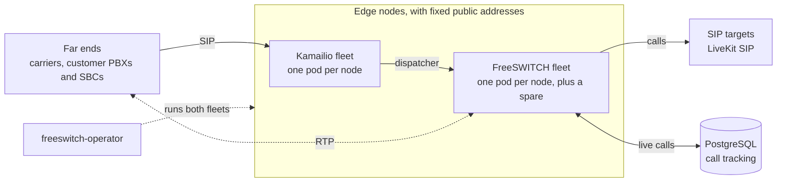

# FreeSWITCH Operator

A Kubernetes operator for running a fleet of FreeSWITCH nodes as a SIP edge (an SBC) behind a Kamailio proxy, plus
**sipbench**, a SIP test bench that checks call flows against that edge before real traffic moves onto it.

> **Status: early.** The API is `v1alpha1` and will change. [Features](#features) lists what works today, and the
> [roadmap](#roadmap) what's still to come. The [sipbench report card](sipbench/report-card/README.md) shows how the
> edge did in the latest release's bench runs.

## Why this exists

FreeSWITCH runs well on Kubernetes once a few non-default things are true, and every team that does it must rebuild
the same pieces by hand:

- **Media needs the node's own network.** Overlay pod networking breaks RTP: signaling succeeds and audio silently
  fails. FreeSWITCH has to run with `hostNetwork: true` and a planned RTP port range, which means one FreeSWITCH
  pod per node.
- **Peers need fixed public addresses.** Carriers and customer PBXs allow-list our IPs, for signaling and often
  for media, in both directions. A pod on the host network uses its node's address, and nodes are replaced all the
  time (upgrades, node expiry, failures). A network load balancer covers inbound signaling only: a request we
  originate leaves from the node's own address, and RTP can't pass through it at all.
- **Calls last minutes; the defaults assume seconds.** A node must stop taking new calls, let its live calls
  finish, and only then go away. That has to hold for rolling updates, node drains and autoscaler consolidation.
- **The proxy in front has to know who can take a call.** Kamailio's dispatcher list must follow the fleet as
  nodes join, drain and leave.
- **Call recovery is an address move.** FreeSWITCH can resume a failed node's tracked calls on another node, but
  only if the far end's packets still arrive. That means the failed node's address moves with its calls, and the
  failed node must never hold it again (no split brain).

## Features

**FreeSWITCH fleet** (`FreeswitchCluster`, [details](docs/freeswitch-fleet.md))
- One FreeSWITCH pod per node on the host network, with a planned RTP range. Any image with `freeswitch` and
  `fs_cli` works.
- Startup and readiness that check the SIP profile Kamailio sends to is actually up. Liveness (hang detection) is
  opt-in.
- Kamailio's dispatcher list kept in step with the nodes that are ready to take calls.
- Drains that wait for live calls to finish, up to a limit, on pod deletion, node drains and evictions.
- Rolling updates one drained node at a time. A replacement that never becomes ready stops the roll, with the rest
  of the fleet still serving.
- Configuration from ConfigMaps, snapshotted per revision, so an edit rolls through the fleet instead of landing in
  running pods.
- Health monitoring from three independent signals (the node, readiness, the operator's own SIP OPTIONS probes), and
  failover that fences a Failed member's node and starts its pod on a spare: on its own (`Automatic`) or when asked.

**Kamailio proxy** (`KamailioCluster`, [details](docs/kamailio.md))
- Kamailio config rendered by the operator, dispatching to one or more FreeSWITCH fleets in priority order, with
  failover on `503` or silence.
- Dispatcher membership reloaded live on every Kamailio pod, and checked until each one holds the list.
- A source allow-list for signaling (`spec.trustedPeers`).
- Refusal of malformed requests that FreeSWITCH would silently drop.
- Authenticated JSON-RPC, and short drains that send new calls to another Kamailio.

**Fixed public addresses** (`SIPAddressPool`, [details](docs/address-pools.md))
- Each node advertises a fixed public address: its own external IP, or one from a pool.
- Pool addresses stay with a node for its life and move to its replacement.
- Providers: AWS Elastic IPs (on the node's own private address or a secondary one), and MetalLB on kind and on-prem.

**Call tracking** ([setup](docs/call-tracking.md))
- FreeSWITCH's core db and per-call tracking in a PostgreSQL shared by the whole fleet: the groundwork for failover.
- SIP profiles named for each node's address (`trunks-<address>`, alias `trunks`), so `sofia recover` takes one
  address's calls and never a live node's: a node whose FreeSWITCH restarts takes back its own calls.
- `ghcr.io/spiegela/freeswitch` ([`images/freeswitch`](images/freeswitch/Dockerfile)): FreeSWITCH 1.11.4, built
  from source ([`images/freeswitch-base`](images/freeswitch-base/Dockerfile)) with `mod_pgsql`, G.722, `mod_lua` and
  `mod_opusfile`, plus the project's own speech detector, cut down to what the edge runs (154 MB).

**Barge-in voice detection** ([details](docs/barge-in.md))
- A per-call switch between detecting the caller's speech at the edge and leaving it to the agent behind LiveKit.
- At the edge: echo cancellation, a Silero or WebRTC voice detector, and each detection sent to the agent as a SIP
  INFO. A patched LiveKit SIP turns those into room data packets.

**Metrics and alerts** ([details](docs/metrics.md))
- Prometheus metrics from Kamailio, FreeSWITCH (an exporter in each pod) and the operator, for an OpenTelemetry
  Collector to scrape.
- Alert rules with promtool tests: silent drops, nodes not answering, stalled rolls and drains, address pool trouble.
- Grafana dashboards for Kamailio, the FreeSWITCH fleet and the operator ([screenshots](docs/dashboards.md)).

**Call tracing** ([details](docs/call-tracing.md))
- One OpenTelemetry trace per call, from HEP copies of the SIP that Kamailio (`spec.capture`) and FreeSWITCH capture,
  and LiveKit's webhooks: every transaction on every hop, failover branches, the bridged leg, the LiveKit room and
  its participants.
- `ghcr.io/spiegela/call-tracer`, exporting to any OTLP/HTTP endpoint (Jaeger, Tempo, VictoriaTraces).

**sipbench** ([details](sipbench/README.md))
- 61 scenarios through the real edge configuration, with mocks behind it: basic calls, failures and fallbacks,
  headers, transfers, keypad tones, codecs, raw-message conformance, network impairments, barge-in.
- Fleet drills on a cluster: a drain mid-call, a rolling update with a live call, a bad config, a node lost mid-call.
- A report card regenerated on every release.

## Architecture



- **Kamailio** holds the fixed signaling addresses and spreads new calls across FreeSWITCH nodes with its
  dispatcher module. Both fleets run on a tainted edge node group, one pod per node.
- **FreeSWITCH** ends every call leg, anchors media and runs the call: bridging, transfers, codecs, headers. Each
  node runs on the host network, one per node, with its RTP range open in the node's security group, and advertises
  its own fixed public address for media. No media relay sits in front of it (see [decisions](#decisions)).
- **PostgreSQL** holds the fleet's shared core db and call tracking, so a spare can take over a lost node's calls
  once call recovery exists: a small in-cluster instance, or a managed service such as Aurora PostgreSQL.
- **The operator** owns both fleets and everything around them: the headless Services, the dispatcher list, each
  node's public address, drains and rolling updates, member health and failover.
- **Behind the edge**, FreeSWITCH bridges calls to a SIP target. In the bench that is sipbench's mock backend; in
  production, LiveKit SIP and through it the agent runtime.

## Documentation

| | |
| --- | --- |
| [The FreeSWITCH fleet](docs/freeswitch-fleet.md) | The `FreeswitchCluster` resource: pods, probes, dispatcher membership, drains, rolling updates, health and failover, configuration |
| [Kamailio](docs/kamailio.md) | The `KamailioCluster` resource: routing, refusals, live membership, JSON-RPC, drains |
| [Address pools](docs/address-pools.md) | Fixed public addresses, the `SIPAddressPool` resource, the AWS and MetalLB providers, the address agent |
| [Call tracking and failover](docs/call-tracking.md) | Setting up call tracking in PostgreSQL, and what call recovery still needs |
| [Barge-in voice detection](docs/barge-in.md) | The edge-or-agent switch, the SIP INFO signal, LiveKit SIP's patch, measurements |
| [Metrics and alerts](docs/metrics.md) | Every metric, the alert rules, scraping |
| [Dashboards](docs/dashboards.md) | The Grafana dashboards for Kamailio, FreeSWITCH and the operator, with screenshots |
| [Call tracing](docs/call-tracing.md) | One trace per call from HEP captures and LiveKit webhooks: setup, nesting, running the tracer |
| [Peers (planned)](docs/peers.md) | Design for per-peer behaviour, outbound registrations and inside-network peers |
| [Development](docs/development.md) | Building, testing, the edge on kind, the report card |
| [sipbench](sipbench/README.md) | The test bench: scenarios, mocks, impairments, the conformance record |
| [Deploying with Flux](deploy/flux/README.md) | An example fleet repository layout |

## Getting started

Try the whole edge on kind: two Kamailio and two FreeSWITCH nodes with a spare, an address pool, PostgreSQL, the mock backend
and monitoring. See [development](docs/development.md#the-edge-on-kind) for what each step sets up.

```sh
make kind-up         # create the cluster (about 6 GB of Docker memory)
make kind-deploy     # build and load the images, install MetalLB and the operator, deploy the edge
make kind-bench      # run sipbench through Kamailio
make kind-down
```

**Deploying.** This repository publishes its images to GHCR (`ghcr.io/spiegela/*`, [decision 4](#decisions)), and
the CRDs and manager manifests as a Kustomize base (`config/`). A separate fleet repository says which version runs where: a Flux `GitRepository` or `OCIRepository`
pointing here at a tag, a `Kustomization` for the operator, and each cluster's fleets and configuration. Promotion
from QA to production is a pull request that moves a tag. [`deploy/flux`](deploy/flux/README.md) has an example
layout, and [`config/samples`](config/samples/) has a sample of each resource.

## Roadmap

Features still to come, each with the stories that make it up.

**Failover with call recovery** ([design](docs/call-tracking.md#failover-what-tracking-is-for-and-whats-left))
- Recover a failed member's calls on the spare it moved to (dead-node detection, fencing and the move are in).
- Have `node-lost-mid-call` check the call survives.
- Check call tracking against a managed PostgreSQL (Aurora), through a database failover.

**Address pools on AWS**
- Run the AWS provider on real clusters: a one-node cluster with `Secondary` addresses, then an EKS edge node group.
- Add a bench scenario for a replaced node's address.
- Add more providers: plain routed addresses (`static`), and other clouds' reserved addresses.

**Peers** ([design](docs/peers.md))
- Typed peer resources, rendered into Kamailio as data that reloads live: recognising a peer by source address,
  Request-URI and number rewrites, answering digest challenges, REFER at the edge or passed on, per-destination
  health checks. `spec.trustedPeers` moves there.
- sipbench peer mocks: one that rejects a wrong Request-URI host or a non-E.164 number, one that challenges each
  call, and registrars that try every contact, keep only the latest, or reject the second.
- Outbound registrations, when the first peer needs them.
- Peers on the inside network (over a VPN, no NAT).
- Refusing a source whose requests the nodes keep discarding, with known peers exempt.

**Kamailio hardening**
- TLS for signaling.
- Rate limiting of scanners (`pike`).

**Fleet**
- Set `karpenter.sh/do-not-disrupt` on pods with live calls, once checked against EKS Auto Mode.

**Barge-in** ([open questions](docs/barge-in.md#open-questions))
- Publish the patched LiveKit SIP image beside the project's own, and offer the change upstream.
- Settle what the agent does in each mode.
- Measure the cost per call, and add an echo scenario to the bench.

**Bench tooling** ([known gaps](sipbench/README.md#known-gaps))
- A stand-in node, so raw-message cases can check a node's responses.
- RFC 3550 jitter and MOS; impairments on the proxy-to-node and edge-to-backend links.
- Re-INVITEs (hold and unhold), early media, and G.722 in the runner.

## Decisions

1. **The operator runs a Kamailio proxy**, as a [`KamailioCluster`](docs/kamailio.md). One operator describes the
   whole edge.
2. **No media relay for now: each FreeSWITCH node advertises its own fixed public address.** rtpengine is the usual
   choice when FreeSWITCH must stay on private addresses or media needs per-direction control. FreeSWITCH already
   anchors media, so it only needs a routable address it can advertise (`ext-rtp-ip`). rtpengine may be added later.
3. **Registrations will live on Kamailio**, whose address is fixed, with the mode chosen per peer. **Per-peer
   behaviour is data in one Kamailio fleet**; a second fleet is for isolation only ([peers](docs/peers.md)).
4. **The project publishes its own images, on GHCR.** Every image the edge needs is built from this repository on
   each release and published for amd64 and arm64 ([`publish.yml`](.github/workflows/publish.yml)):

   | Image | What it is |
   | --- | --- |
   | `ghcr.io/spiegela/freeswitch-operator` | The operator, and the address agent |
   | `ghcr.io/spiegela/freeswitch-exporter` | The FreeSWITCH metrics exporter, versioned apart so an operator upgrade never rolls a fleet |
   | `ghcr.io/spiegela/freeswitch-base` | FreeSWITCH 1.11.4 built from source, with its compilers and headers: what the image below builds on ([`images/freeswitch-base`](images/freeswitch-base/Dockerfile)) |
   | `ghcr.io/spiegela/freeswitch` | FreeSWITCH 1.11.4 with `mod_pgsql` for call tracking and `mod_speech_detect` for barge-in, cut down for an edge ([`images/freeswitch`](images/freeswitch/Dockerfile)) |
   | `ghcr.io/spiegela/sipbench` | The test bench: the runner, the mock backend and the stand-in LiveKit agent |

   A release is tagged `latest` and `sha-<commit>`, and a `v*` git tag adds its version. FreeSWITCH is the project's
   own build: the base image compiles FreeSWITCH 1.11.4 from SignalWire's source on Debian bookworm, with sofia-sip,
   spandsp and libfvad from theirs, each pinned by tag and commit. It builds only the modules an edge uses, plus G.722
   (`mod_spandsp`), `mod_lua` and `mod_opusfile`, and leaves out video. The edge's image compiles the barge-in
   detectors against it (`mod_speech_detect`, Apache-2.0, on Silero VAD and ONNX Runtime, both MIT) and strips what
   it keeps: 154 MB, which every node pulls on install, upgrade and failover. The base is built natively for each
   platform (it compiles FreeSWITCH, too slow emulated), and only rebuilds when it changes.

   **The open-source project stands on its own.** Its images, docs and samples name only public sources. An
   organisation running the edge internally mirrors the images into its own registry (ECR, say) from its own
   deployment repository; that mirroring doesn't live here.

## Open questions

1. **Do peers allow-list media addresses?** If none do, FreeSWITCH nodes can keep advertising their node's own
   public address, and address pools can cover Kamailio first.
2. **Does the edge become the default barge-in detector?** Both are built and switchable per call
   ([barge-in](docs/barge-in.md)). Making the edge the default means sizing capacity with detection on every call.

## Sponsorship

freeswitch-operator is developed with the sponsorship of [Computer Instruments](https://instruments.com), which
runs it as the SIP edge in front of its voice agents. The project is open source under the Apache License, and
contributions and issues from anyone running FreeSWITCH on Kubernetes are welcome.

## License

Apache License 2.0; see [`LICENSE`](LICENSE).
