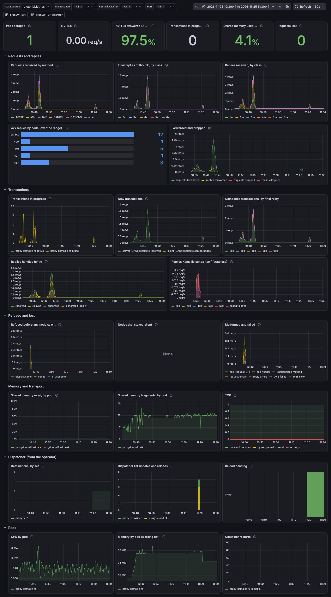
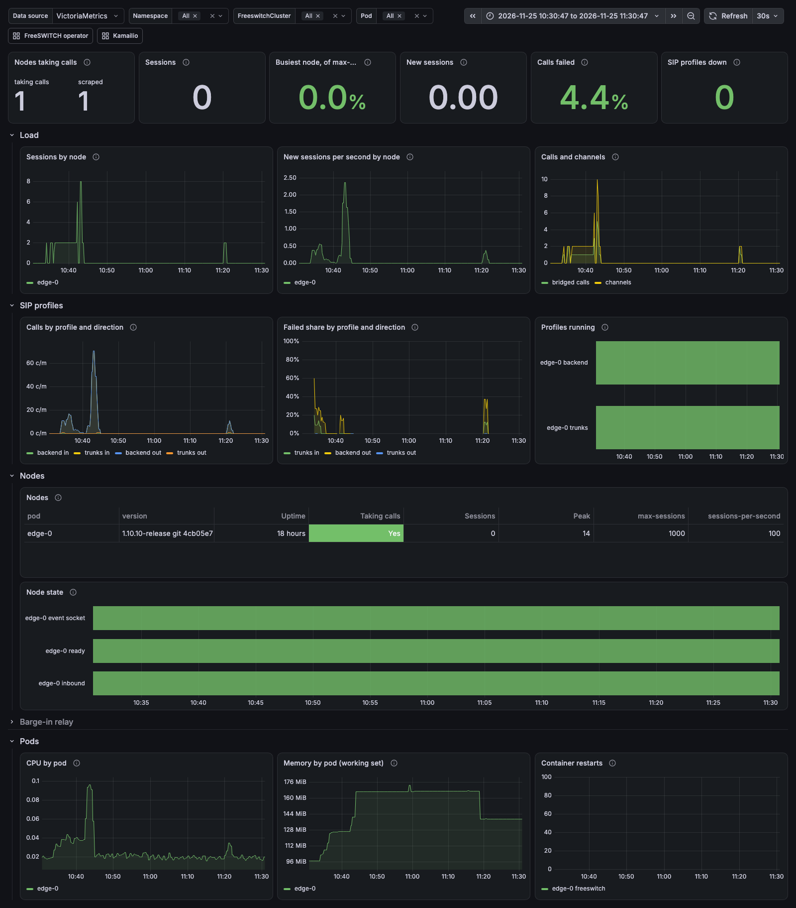
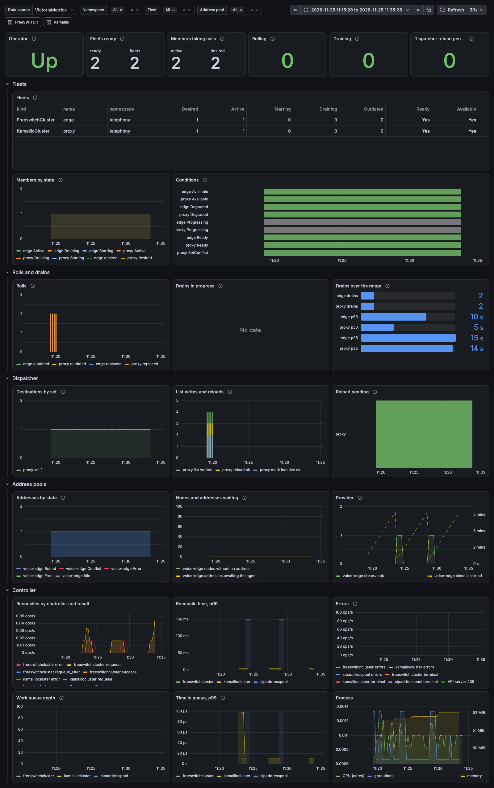

# Grafana dashboards

**Three dashboards, one each for Kamailio, the FreeSWITCH fleet and the operator, in
[`config/grafana`](../config/grafana).** They're linked to each other, and each picks its Prometheus data source and
fleet from variables at the top. They read the [metrics](metrics.md) the edge serves, scraped as that page's
"Scraping" section describes (`job` = `kamailio`, `freeswitch` or `freeswitch-operator`, with `namespace`, `pod` and
`fleet` labels).

```bash
kubectl apply -k config/grafana -n <namespace>
```

That makes them ConfigMaps labeled `grafana_dashboard=1` (folder Edge) for Grafana's dashboard sidecar to load. Without
the sidecar, import the JSON. They're generated by [`hack/dashboards/dashboards.py`](../hack/dashboards/dashboards.py):
change that and run `make dashboards`. `make check-dashboards`, which CI runs, fails on JSON that doesn't match it.

The screenshots are from a single-node sandbox (one Kamailio, one FreeSWITCH). Kamailio's and FreeSWITCH's cover an
hour of [sipbench](../sipbench) scenarios: calls answered, refused, cancelled and transferred, failover, codecs, DTMF,
impairment and the raw-SIP validation set. The operator's covers its first 20 minutes of scraping, with the fleets
steady.

## Kamailio



- **At the top:** pods scraped, INVITEs per second, the share of INVITEs answered (the proxy's answer-seizure ratio,
  over the range), transactions in progress, shared memory used, and requests lost (no node answered).
- **Requests and replies:** requests by method; final replies to INVITE by class; replies by class; 4xx replies by
  code over the range (`487` is a cancelled call, `486` busy, `408` a node that stayed silent); what Kamailio forwarded
  and dropped.
- **Transactions:** in progress, new (received, and sent on to nodes), completed by final reply; what tm did with
  replies; the replies Kamailio sends itself.
- **Refused and lost:** what the edge refuses before any node sees it, by reason; nodes that stayed silent and the
  requests no node answered; malformed requests and replies, unsupported methods and DNS failures.
- **Memory and transport:** shared memory used and its peak, as shares of the pool; free fragments (rising with
  usage flat is fragmentation); TCP connections, queued bytes and errors.
- **Dispatcher (from the operator):** destinations per dispatch set, list writes and reloads, a reload pending.
- **Pods:** CPU and memory against requests and limits, restarts.

## FreeSWITCH



- **At the top:** nodes taking calls, sessions, the busiest node's share of its `max-sessions`, new sessions per
  second, the share of calls failed, SIP profiles down.
- **Load:** sessions and new sessions per second by node (each node's `max-sessions` and `sessions-per-second` are in
  the Nodes table); bridged calls and channels.
- **SIP profiles:** calls by profile (`trunks`, `backend`) and direction, the share failed, and each profile's state
  over time.
- **Nodes:** a table of each node's version, uptime and limits, and its state over time (up, ready, draining).
- **Barge-in relay** (collapsed): whether the exporter's relay is subscribed, and its voice detections
  ([barge-in](barge-in.md)).
- **Pods:** FreeSWITCH's CPU and memory against its requests and limits, restarts.

## FreeSWITCH operator



- **At the top:** the operator up, fleets ready, members taking calls against the replicas asked for, members
  rolling and draining, dispatcher reloads pending.
- **Fleets:** every KamailioCluster and FreeswitchCluster, members by state (Starting, Active, Draining), and each
  fleet's conditions over time.
- **Rolls and drains:** members not on the latest template and pods replaced; each drain in progress against its
  fleet's `drain.maxDrainSeconds`; the drains that finished in the range and how long they took.
- **Dispatcher:** destinations by set; list writes, reloads and nodes marked inactive; a reload pending.
- **Address pools:** addresses by state, nodes and addresses waiting, and the provider: calls by result and how long
  since the pool last read it.
- **Controller:** reconciles by controller and result, their p99 time, errors, work queue depth and time in queue,
  and the process's CPU, memory and goroutines.

## Not measured yet

So not on them: media quality (MOS, jitter, loss: FreeSWITCH reports them per call at hangup), hangup causes and
post-dial delay, and dispatcher probing state as Kamailio sees it.
